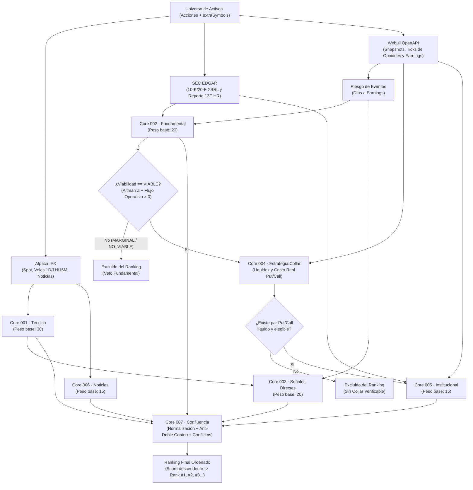

# Arquitectura de Cores Cuantitativos y Generación del Ranking

Este documento explica el funcionamiento interno del motor de evaluación cuantitativa (**Strategy Screener v2**), con énfasis especial en el **Core Institucional (005)** y en la mecánica exacta que determina cómo se calcula y ordena el **Ranking final** en el dashboard.

---

## 1. Visión General: ¿Cómo se construye el Ranking?

En el dashboard conviven dos capas de ranking complementarias:

1. **Escáner Base Rápido (`/api/v2/market/scanner/top-collars`):**  
   Evalúa la canasta de mercado (más cualquier empresa que añadas manualmente) usando cotización spot del broker y valuación teórica **Black-Scholes** para estimar strikes OTM (~5%), primas y probabilidad de piso seguro. Permite ordenar por *Probabilidad*, *Crédito Neto* o *Retorno Máximo*.
2. **Evaluación de Cores Cuantitativos (`/api/v2/strategy-screener/run`):**  
   Al presionar **"Evaluar Cores Cuantitativos"**, el sistema ejecuta un pipeline de datos reales multi-fuente (**Alpaca Market Data**, **SEC EDGAR** y **Webull OpenAPI**) que calcula 7 cores independientes, aplica vetos duros de solvencia/liquidez y sintetiza un puntaje comparable de **0 a 100** en el **Core 007 (Confluencia)**. Al finalizar, la tabla principal se reordena automáticamente por este puntaje (`sortBy = 'cores'`).

> **Nota sobre ETFs:** El universo de Cores Cuantitativos excluye ETFs como `SPY` y `QQQ` porque no presentan estados financieros `10-K`/`20-F` ante la SEC (EDGAR).

### Flujo de Ejecución del Pipeline



---

## 2. Foco Principal: ¿Cómo funciona el Core Institucional (005)?

El **Core 005 (`institutionalCore`)** busca detectar huellas de capital grande (*smart money*), presión direccional en el mercado de opciones y contexto de tenencias institucionales públicas. Su implementación vive en:
- Lógica de cálculo: `src/api/v2/services/strategyScreener/optionsCores.js`
- Flujo de opciones (ticks): `src/api/v2/services/strategyScreener/marketData.js` (`optionFlow`)
- Tenencias 13F: `src/api/v2/services/strategyScreener/edgar.js` (`holdingsReport` y `reportedHoldings`)

### 2.1. Fuentes de Datos Reales del Core 005

El Core 005 cruza **dos fuentes completamente distintas**:

1. **Flujo Intradía de Opciones (Webull OpenAPI + Alpaca Contratos):**
   - Primero, `optionsChain` obtiene de Alpaca los contratos estándar (multiplicador 100) dentro del horizonte DTE solicitado ($\pm 10$ días) y con strikes entre $88\%$ y $112\%$ del precio spot, y consulta sus cotizaciones reales en **Webull OpenAPI** (`/market-data/options/snapshots/list`) verificando que no tengan retraso mayor a 15 minutos.
   - Luego, `optionFlow` selecciona los **2 contratos con mayor volumen negociado del día** (`volume > 0`, `open_interest >= 0`).
   - Por cada uno de esos contratos, consulta hasta los últimos **120 ticks reales** ejecutados durante la sesión regular en **Webull OpenAPI** (`/market-data/options/ticks/list`). Cada tick incluye precio, volumen (`size`) y lado agresor (`B` compra o `S` venta, si el feed lo informa).

2. **Reporte Institucional SEC EDGAR `13F-HR`:**
   - Consulta las presentaciones públicas en `data.sec.gov` para el gestor institucional de referencia (**Berkshire Hathaway**, CIK `0001067983`).
   - Localiza el formulario **`13F-HR`** más reciente cuya antigüedad no supere los 190 días.
   - Descarga el archivo XML de posiciones (`infoTable`) desde los archivos de EDGAR, parsea cada registro (`cusip`, `sshPrnamt`, `nameOfIssuer`, `putCall`) y busca coincidencias exactas contra el **CUSIP** del ticker evaluado (por ejemplo, `037833100` para `AAPL`).
   - Si el reporte 13F está temporalmente indisponible, el Core 005 **no falla**, pero marca su estado como `PARTIAL` con la nota *"El contexto 13F está temporalmente indisponible"*.

### 2.2. Cálculos por Contrato ("Zonas de Actividad")

Para cada contrato analizado se construye una zona con las siguientes métricas:

| Métrica | Fórmula / Condición | Interpretación |
| :--- | :--- | :--- |
| **Ratio Volumen / Interés Abierto (`volumeToInterest`)** | $\dfrac{\text{volume}}{\text{openInterest}}$ | Mide cuánta actividad nueva entra hoy respecto al tamaño total de posiciones previas. |
| **Actividad Inusual (`unusual`)** | $\text{volumeToInterest} > 1$ | Hoy se negociaron más contratos que todo el *open interest* acumulado. |
| **Flujo Grande (`largeFlow`)** | $\text{volumeToInterest} \ge 5 \;\land\; \text{totalSamplePremium} \ge \$500{,}000$ | Señal de flujo institucional agresivo ("ballena") en la muestra. |
| **Prima Total Muestreada (`totalSamplePremium`)** | $\sum (\text{size} \times \text{price} \times 100)$ | Capital total en USD movido en los ticks observados. |
| **Prima Direccional con Signo (`signedSamplePremium`)** | $\sum (\text{size} \times \text{price} \times 100 \times s_{\text{lado}} \times s_{\text{tipo}})$ | Capital neto alcista o bajista según el lado del trade y tipo de opción (ver tabla inferior). |
| **Exposición Gamma (`gammaOpenInterest`)** | $\text{gamma} \times \text{openInterest} \times 100$ | Aproximación de exposición bruta gamma en ese strike (sin asumir signo de *dealer*). |

**Convención de Signo Direccional (`signedSamplePremium`):**

| Operación en la Muestra | Lado (`s_lado`) | Tipo (`s_tipo`) | Signo Resultante | Lectura de Mercado |
| :--- | :---: | :---: | :---: | :--- |
| **Compra de Call** | `+1` (`B`) | `+1` (`call`) | **`+1`** | Presión **Alcista** |
| **Venta de Call** | `-1` (`S`) | `+1` (`call`) | **`-1`** | Presión **Bajista** / Techo |
| **Compra de Put** | `+1` (`B`) | `-1` (`put`) | **`-1`** | Presión **Bajista** / Cobertura |
| **Venta de Put** | `-1` (`S`) | `-1` (`put`) | **`+1`** | Presión **Alcista** / Piso |

### 2.3. Dirección, Intensidad y Puntaje Final del Core 005

Una vez agregadas las zonas del activo:

1. **Sesgo neto (`tilt`):**
   $$\text{tilt} = \begin{cases} \dfrac{\sum \text{signedSamplePremium}}{\sum \text{totalSamplePremium}} & \text{si } \sum \text{totalSamplePremium} > 0 \\ 0 & \text{en caso contrario} \end{cases}$$

2. **Dirección (`direction`):**
   - Solo se asigna dirección (`+1` `BULLISH` o `-1` `BEARISH`) si existen al menos **3 operaciones con lado conocido** (`known >= 3`) **y** el sesgo absoluto es significativo ($|\text{tilt}| \ge 0.20$).
   - Si hay menos de 3 operaciones con lado conocido, se clasifica como `UNDETERMINED` (`direction = 0`, confianza `0.45`).
   - Si hay 3 o más operaciones pero $|\text{tilt}| < 0.20$, se clasifica como `NEUTRAL` (`direction = 0`, confianza `0.72`).

3. **Intensidad (`intensity`, de 0 a 100):**
   $$\text{intensity} = \text{clamp}\!\left(\max_i\!\left(\text{volumeToInterest}_i \times 25\right) + \log_{10}(1 + \text{totalSamplePremium}) \times 7,\; 0,\; 100\right)$$
   Combina la magnitud del volumen relativo contra el interés abierto con la escala logarítmica del dinero total movido en primas.

4. **Puntaje final del Core 005 (`score`):**
   $$\text{score}_{005} = \text{clamp}\!\left(66 + 0.20 \times \text{direction} \times \text{intensity},\; 0,\; 100\right)$$
   - Base neutral: **66 puntos** (si es neutral o indeterminado).
   - Flujo institucional alcista fuerte (`direction = +1`, `intensity = 100`): hasta **86 puntos**.
   - Flujo institucional bajista fuerte (`direction = -1`, `intensity = 100`): baja hasta **46 puntos**.

5. **Limitaciones declaradas por diseño:**  
   El sistema documenta explícitamente en su respuesta que el lado informado aproxima la presión de la muestra (no identifica la contraparte ni si el trade abre o cierra posición) y que `gammaOpenInterest` es exposición bruta sin signo de *dealer*.

---

## 3. Funcionamiento del Resto de los Cores

### Core 001 — Análisis Técnico Multi-Timeframe (`technicalCore.js`)
- **Fuente:** Velas cerradas de **Alpaca Market Data IEX** en 3 marcos temporales: `1Day`, `1Hour` y `15Min` (mínimo 60 velas cerradas por marco).
- **Indicadores calculados por timeframe:**
  - Tendencia: `EMA 20`, `EMA 50`, pendiente de `EMA 20`, estructura de máximos/mínimos y fuerza `ADX(14) >= 20`.
  - Momentum: `RSI(14)` (alcista en $[55, 75)$, bajista en $(25, 45]$), histograma `MACD(12, 26, 9)` y `ROC(10)`.
  - Volatilidad y ruptura: `ATR(14)` vs media de 20 periodos, Bandas de Bollinger $(20, 2\sigma)$, volumen relativo ($> 1.2$ para confirmar ruptura) y zonas de soporte/resistencia por pivotes.
- **Cálculo de sesgo (`bias` en $[-100, 100]$):**
  $$\text{bias} = \text{clamp}\!\Big((45 \cdot d_{\text{daily}} + 25 \cdot c_{\text{daily}} + 15 \cdot c_{\text{hourly}} + 15 \cdot b_{\text{15m}}) \times (1 - 0.25 \cdot \text{conflictos}),\; -100,\; 100\Big)$$
  Donde `conflictos` cuenta cuántos marcos menores (`1Hour`, `15Min`) contradicen la dirección diaria.
- **Dirección:** $+1$ si $\text{bias} \ge 25$, $-1$ si $\text{bias} \le -25$, $0$ en otro caso.
- **Puntaje y confianza:**
  $$\text{score}_{001} = \text{clamp}(68 + 0.28 \times \text{bias},\; 0,\; 100), \qquad \text{confidence} = 0.82 - 0.15 \times \text{conflictos}$$

---

### Core 002 — Análisis Fundamental, Solvencia y Riesgo de Eventos (`fundamentalCore.js` + `edgar.js`)
- **Fuentes:**
  - **SEC EDGAR:** Estados financieros auditados (`10-K` o `20-F`) de los últimos **2 ejercicios fiscales consecutivos** en formato XBRL (`us-gaap`).
  - **Webull Financial Alerts:** Ventana de próximos reportes de ganancias (*earnings*). Si la alerta no responde, se estima de forma segura a 60 días para no bloquear la evaluación.
- **Modelos financieros aplicados:**
  1. **Altman Z-Score:**
     - Empresas manufactureras públicas (SIC `2000–3999`): $Z = 1.2 X_1 + 1.4 X_2 + 3.3 X_3 + 0.6 X_4 + X_5$ (umbrales `1.81` y `2.99`).
     - Empresas no manufactureras: $Z'' = 6.56 X_1 + 3.26 X_2 + 6.72 X_3 + 1.05 X_4$ (umbrales `1.10` y `2.60`).
     - Empresas financieras (SIC `6000–6999`): no aplica Altman Z.
  2. **Piotroski F-Score:** Evalúa hasta **9 pruebas binarias** de salud contable (ROA positivo, flujo operativo positivo, mejora de ROA, calidad de flujo de caja, reducción de deuda a largo plazo, mejora de liquidez corriente, no dilución de acciones, mejora de margen bruto y mejora de rotación de activos). Requiere al menos 6 pruebas evaluables.
- **Regla de Veto Duro (Elegibilidad):**
  - `NO_VIABLE`: si $Z < Z_{\text{lower}}$.
  - `MARGINAL`: si $Z \le Z_{\text{upper}}$ o `cashFlow <= 0` o `operatingIncome <= 0`.
  - `VIABLE`: pasa solvencia y tiene utilidad operativa y flujo operativo positivos.
  - **Efecto en el ranking:** Cualquier empresa `MARGINAL` o `NO_VIABLE` queda **vetada automáticamente** y no entra a los candidatos ni se consulta su cadena de opciones.
- **Puntaje del Core 002 (0 a 100):**
  $$\text{score}_{002} = 0.25 \cdot \text{Calidad} + 0.25 \cdot \text{Solvencia} + 0.15 \cdot \text{Crecimiento} + 0.15 \cdot \text{Valuación} + 20 \cdot \frac{\text{F-Score aprobadas}}{\text{F-Score evaluadas}}$$
  - *Calidad:* $\text{clamp}(50 + \text{margenOperativo} \times 100)$
  - *Solvencia:* $\text{clamp}(45 + (Z - Z_{\text{lower}}) \times 18)$
  - *Crecimiento:* $\text{clamp}(50 + \text{crecimientoIngresos} \times 140)$
  - *Valuación:* $\text{clamp}(100 - 1.6 \cdot \text{P/E} - 2 \cdot \text{P/S})$ (o `20` si no hay utilidades positivas)
- **Riesgo de Earnings (`eventRisk`):** `HIGH` si faltan $\le 7$ días, `MEDIUM` si faltan $\le 30$ días, `LOW` si faltan $> 30$ días.

---

### Core 003 — Señales Directas (`directSignalsCore` en `technicalCore.js`)
- **Dependencia:** Consume directamente el resultado del **Core 001** y el **Riesgo de Eventos** (earnings).
- **Reglas de decisión:**
  - Si `risk === 'HIGH'` (earnings en 7 días o menos): fuerza señal `HOLD` (`side = 0`, regla `EVENT_RISK`) y resta **20 puntos**.
  - Si el riesgo no es alto, la tendencia diaria y horaria coinciden con la dirección del Core 001 **y** $|\text{bias}| \ge 45$: emite `BUY` (`+1`) o `SELL` (`-1`, regla `DIRECTION_CONFIRMED`).
  - En cualquier otro caso: `HOLD` (`INSUFFICIENT_CONFIRMATION`).
- **Puntaje y confianza:**
  $$\text{score}_{003} = \text{clamp}\!\Big(65 + \text{side} \times |\text{bias}| \times 0.30 - (\text{risk} == \text{HIGH} ? 20 : 0),\; 0,\; 100\Big)$$
  Confianza: `0.78` si emite `BUY`/`SELL`, `0.50` si emite `HOLD`.

---

### Core 004 — Validación de Estrategia Collar Spread (`strategyCore` en `optionsCores.js`)
- **Rol:** No compite por peso porcentual; funciona como **compuerta obligatoria de ejecutabilidad** sobre la cadena real de opciones.
- **Filtro de liquidez por contrato:**
  - Contrato estándar (`multiplier === 100`).
  - `bid > 0` y `ask >= bid`.
  - Spread bid-ask relativo $\le 35\%$: $\dfrac{2(\text{ask} - \text{bid})}{\text{ask} + \text{bid}} \le 0.35$.
  - `openInterest >= 10` y `volume >= 1`.
- **Selección del par óptimo (Put + Call):**
  - Empareja un **Put OTM** (`strike < spot`, idealmente ~95% del spot) con un **Call OTM** (`strike > spot`, idealmente ~105% del spot) del mismo vencimiento.
  - Ordena priorizando: cercanía al horizonte DTE (30, 45 o 60 días) $\rightarrow$ cercanía a 95%/105% $\rightarrow$ menor spread combinado.
  - Exige consistencia económica: el costo base ($\text{basis} = \text{spot} + \text{putAsk} - \text{callBid}$) debe cumplir $\text{putStrike} \le \text{basis} \le \text{callStrike}$.
- Si no existe un par compatible y líquido, el activo pasa a `excluded`.

---

### Core 006 — Noticias y Sentimiento (`newsCore` en `confluenceCores.js`)
- **Fuente:** **Alpaca News** (`/v1beta1/news`) en ventana de los últimos **7 días**.
- **Limpieza:** Deduplica artículos por ID de fuente, URL sin query params y titular normalizado.
- **Clasificación y puntaje por artículo:**
  - Detecta categoría de evento (`EARNINGS`, `M&A`, `REGULATORY`, `MACRO`, u `OTHER` que pondera `0.6`).
  - Evalúa reglas de lenguaje financiero en inglés (`beats estimates`, `raises guidance`, `upgrades` vs `misses`, `cuts guidance`, `downgrades`, `antitrust`, `recall`), dando peso `1.0` al titular y `0.5` al resumen, acotado a $[-1, 1]$.
  - **Relevancia:** $1 / \sqrt{\text{número de símbolos mencionados en la noticia}}$ (una noticia dedicada exclusivamente a la empresa pesa más que una mención en un listado de 10 empresas).
  - **Frescura:** Decaimiento exponencial $e^{-\Delta t / 3\text{ días}}$ (las noticias recientes pesan mucho más que las de hace una semana).
  - **Impacto del artículo:** $\text{sentimiento} \times \text{relevancia} \times \text{frescura} \times \text{factorEvento}$.
- **Agregación:** Toma los **8 titulares de mayor impacto absoluto**, calcula $\text{impact} = \text{clamp}(45 \cdot \sum \text{impacto}_i, -100, 100)$.
- **Dirección y puntaje:**
  - Dirección $+1$ (`POSITIVE`) si $\text{impact} \ge 15$, $-1$ (`NEGATIVE`) si $\text{impact} \le -15$, `0` (`NEUTRAL`) en medio.
  $$\text{score}_{006} = \text{clamp}(66 + 0.28 \times \text{impact},\; 0,\; 100)$$

---

## 4. Core 007 (Confluencia): ¿Cómo se calcula el Score y el Ranking Final?

El **Core 007 (`confluenceCore` en `confluenceCores.js`)** toma únicamente los cores que el usuario dejó marcados como activos (`activeCores`) y produce el puntaje final con el que se ordena el ranking.

### 4.1. Pesos Base y Ajuste Anti-Doble Conteo

Cada core fuente tiene un peso base configurado:

| Core | Nombre | Peso Base | Peso Efectivo (si los 5 cores están activos) |
| :---: | :--- | :---: | :---: |
| **001** | Técnico Multi-Timeframe | `30` | **22.50%** |
| **002** | Fundamental & Solvencia | `20` | **25.00%** |
| **003** | Señales Directas | `20` | **15.00%** |
| **005** | Flujo Institucional | `15` | **18.75%** |
| **006** | Noticias & Sentimiento | `15` | **18.75%** |

**¿Por qué cambian los porcentajes cuando 001 y 003 están activos a la vez?**  
Porque el Core 003 se construye a partir de las observaciones técnicas del Core 001. Para evitar que lo técnico se cuente doble y opaque al resto de los motores:
- Si **ambos** (`001` y `003`) están seleccionados, sus pesos se reescalan por $\dfrac{30}{30 + 20} = 0.60$:
  - `001` pasa de $30 \rightarrow 18$
  - `003` pasa de $20 \rightarrow 12$
  - Juntos suman $30$ (el peso original del bloque técnico) en vez de $50$.
- Luego se divide cada peso entre la suma total activa ($18 + 12 + 20 + 15 + 15 = 80$), normalizando exactamente al **100%**.
- Si el usuario desactiva algún core (por ejemplo, deja solo `002` y `005`), los pesos se renormalizan automáticamente entre los cores activos seleccionados.

### 4.2. Fórmula del Score Final de Confluencia

$$\text{Score}_{\text{final}} = \sum_{i \in \text{activos}} \left(\text{score}_i \times w_i^{\text{normalizado}}\right)$$

Si falta el puntaje numérico finito de cualquiera de los cores seleccionados como activos, la empresa no recibe puntaje de confluencia y pasa a `excluded` indicando qué cores tuvieron datos insuficientes.

### 4.3. Confianza, Conflictos y Señal (`BUY` / `SELL` / `HOLD`)

Para evitar señales falsas:
1. **Agrupación independiente:** Los cores `001` y `003` pertenecen al mismo grupo (`001`), de modo que no pueden "auto-confirmarse" como dos fuentes independientes.
2. **Detección de conflictos:** Si al menos un grupo independiente apunta alcista (`direction > 0`) y otro apunta bajista (`direction < 0`), se marca `conflict = true`.
3. **Confianza ponderada:**
   $$\text{confidence} = \text{clamp}\!\left(\left(\sum_{i} \text{confidence}_i \cdot w_i^{\text{normalizado}}\right) \times (\text{conflict} ? 0.70 : 1.0),\; 0,\; 0.94\right)$$
   Un conflicto entre cores penaliza la confianza en un **30%**.
4. **Señal consolidada (cuando hay 2 o más cores activos):**
   - `BUY`: sin conflicto, `confidence >= 0.65` y al menos **2 grupos independientes** en dirección alcista.
   - `SELL`: sin conflicto, `confidence >= 0.65` y al menos **2 grupos independientes** en dirección bajista.
   - `HOLD`: en caso de conflicto, baja confianza o falta de consenso entre al menos 2 grupos.

### 4.4. Reglas Exactas de Ordenamiento y Exclusión del Ranking

En `src/api/v2/services/strategyScreener.service.js`:

1. **Filtro de Exclusiones (`excluded`):** Un activo queda fuera del ranking de candidatos si cumple cualquiera de estas condiciones:
   - Tiene veto fundamental (`MARGINAL` o `NO_VIABLE`).
   - Su viabilidad no pudo verificarse (`UNKNOWN`) o fallaron sus datos de eventos/opciones.
   - El Core 004 determinó que no existe un par Collar líquido y verificable (`eligible: false`).
   - Alguno de los cores activos seleccionados no devolvió un `score` válido.
2. **Ordenamiento de Candidatos (`candidates`):**
   ```javascript
   rows
     .filter(row => !row.reason)
     .sort((a, b) => b.score - a.score || a.symbol.localeCompare(b.symbol))
     .slice(0, criteria.limit)
     .map(({ incomplete, ...row }, index) => ({ ...row, rank: index + 1 }));
   ```
   - **Criterio primario:** Mayor `score` del Core 007 (descendente).
   - **Desempate:** Orden alfabético por `symbol`.
   - Se asigna la posición `rank` (`1, 2, 3...`) hasta el límite configurado (`limit`).
3. **Reflejo en la Interfaz (`Dashboard.jsx`):**
   - Al recibir el resultado de la API, el dashboard cambia el criterio de ordenamiento a `cores` (`setSortBy('cores')`) y muestra las empresas aprobadas arriba de la tabla ordenadas por su puntaje del Core 007, conservando sus evidencias auditables (fuente, timestamp y referencia de cada observación).
