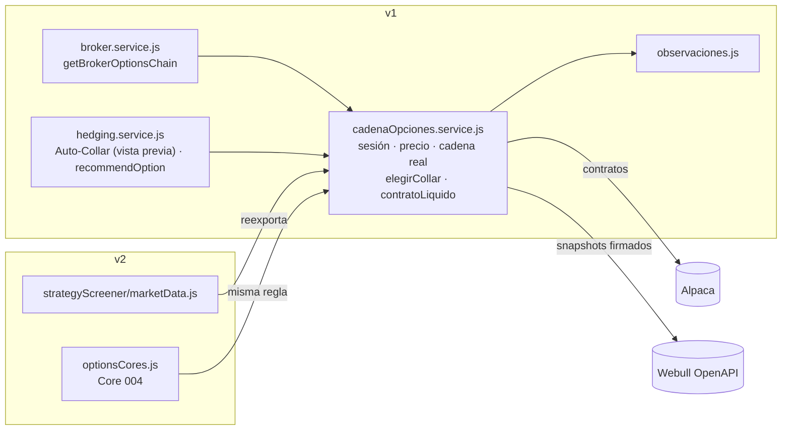

# REPORT-DrFIC — `cadena-de-opciones-real`

## Resumen ejecutivo

Las cadenas de opciones sintéticas desaparecieron. Antes tenían strikes redondeados y primas `intrínseco + 2.0/3.5 + Math.random()`.

- **Cadena real compartida**: `GET /broker/options-chain`, la recomendación de opciones y el Auto-Collar usan, en los tres brokers, la misma cadena real del screener. Son contratos listados de Alpaca con cotizaciones firmadas de Webull OpenAPI. Cada contrato trae `bid`, `ask`, volumen, interés abierto, instante, retraso y fuente. Si no hay contratos cotizados, la respuesta es `503`.
- **Auto-Collar**: elige con la misma regla del Core 004 (liquidez, 95 %/105 % y costo base), así que ejecuta el collar que muestra el ranking.
- **Vista previa**: con `executeOrders: false` devuelve el collar con sus cotizaciones y métricas, sin órdenes ni registros.
- **Recomendación de Put**: devuelve un contrato listado con su `ask` observado.

## Atribución

| Trabajo | Autoría |
|---|---|
| Pruebas, implementación, contrato, verificación y este reporte | Asistido por IA (Claude Code), a solicitud de Eddie Altamirano |
| Revisión humana del código | Pendiente |

## Diagrama C4 (nivel de componentes)

## Lógica integrada

- **Servicio compartido** (`src/api/v1/services/cadenaOpciones.service.js`):
  - Se extrajeron de `marketData.js`, sin cambios de comportamiento:
    - clientes firmados de Alpaca y Webull;
    - sesión bursátil y precio del subyacente;
    - normalización de contratos;
    - `obtenerCadenaOpciones`.
  - `marketData.js` los reexporta: el screener usa la misma función (la prueba lo comprueba por identidad).
  - Los helpers de observaciones pasaron a `v1`, y `v2` los reexporta. Así `v2` depende de `v1` y no al revés.
- **Regla del Core 004 compartida**: `contratoLiquido` y `elegirCollar`. `strategyCore` las usa, y las pruebas del screener siguen iguales (9 de 9).
- **`getBrokerOptionsChain`**:
  - Usa la misma cadena para Alpaca, Webull e IBKR.
  - `expiration` es opcional: sin él se usa un horizonte de 45 días; con él se filtra ese vencimiento y responde `503` si no está cotizado.
  - Se eliminaron `getWebullOptionsChain` y el respaldo sintético de `getIBKROptionsChain`.
- **Auto-Collar**:
  - Pide la cadena real y elige con `elegirCollar`. La vista previa (`preview`) incluye contratos, cotizaciones y métricas.
  - El pre-vuelo de bases de datos solo corre al ejecutar.
  - Se retiró el filtro Black-Scholes, que dependía de volatilidades supuestas (0.35, o 0.48 para NVDA).
  - El flujo de ejecución usa ahora los contratos y el vencimiento reales. Su reescritura completa (orquestador de patas y precios recotizados) corresponde a `ejecucion-de-coberturas-multipata`.
- **Controlador**: `executeOrders` vale `false` por defecto, como documentaba el contrato.
  - Antes, un Auto-Collar sin ese campo emitía órdenes reales.
  - El panel envía `true` de forma explícita, así que no cambia.
  - La vista previa responde `200`, y la ejecución `201`.
- **`recommendOption`**: usa contratos listados y líquidos del tipo pedido, con objetivo 95 %/105 % (OTM), el precio (ATM) o el lado contrario (ITM). Ya no calcula primas teóricas.

## Registro de tareas

Los tiempos son las fechas de modificación reales de los archivos de cada tarea (UTC−07:00).

| Tarea | Archivo | Momento |
|---|---|---|
| 1.1–1.2 Pruebas del servicio y de las rutas (fase roja: falta el módulo) | `test/cadenaOpciones.test.js` | 2026-11-20 23:17:58 |
| 2.1 Observaciones en `v1` y servicio compartido | `observaciones.js`, `cadenaOpciones.service.js` | 2026-11-20 23:18:35 |
| 2.3 Regla del Core 004 compartida | `optionsCores.js` | 2026-11-20 23:18:49 |
| 2.2 Cadenas reales en los tres brokers | `broker.service.js`, `webull.service.js`, `ibkr.service.js` | 2026-11-20 23:18:49 |
| 2.4 Vista previa del Auto-Collar y recomendación del Put | `hedging.service.js` | 2026-11-20 23:19:55 |
| 2.4 Controlador (vista previa por defecto, 200) | `hedging.controller.js` | 2026-11-20 23:20:43 |
| 3.1 OpenAPI y Postman | `spec/openspec.yaml`, colecciones | 2026-11-20 23:21:02 |
| 3.2 Pruebas de calidad y consulta real | `resultados.json` | 2026-11-20 23:21:41 |

## Verificación

- **`npm test`**: 115 de 115, incluidas 5 pruebas nuevas:
  - cadena compartida con descarte de retraso mayor a 15 minutos;
  - `503` sin contratos o con el proveedor caído;
  - `options-chain` igual en los tres brokers y sin contratos ajenos;
  - vista previa igual a `strategyCore` y sin `axios.post`;
  - Put recomendado listado con `ask`, instante y fuente.
- **`npm run test:api-quality`**: `RESULTADO PASS: 113 pruebas aprobadas, 0 fallidas`. Los 5 hallazgos de seguridad y monitoreo ya existían.
- **Consulta real** (2026-11-20 23:21 −07:00; última sesión 2026-11-20):

  | Consulta | Resultado |
  |---|---|
  | Cadena de AAPL | Precio 343.40 (21:00Z); vencimientos 2026-12-31 y 2027-01-15; 12 contratos. Ejemplo: `AAPL261231P00325000`, bid 5.70, ask 8.40, cotizado 21:00:00Z, retraso de 15 min |
  | Vista previa del Auto-Collar | Put `AAPL261231P00330000` (ask 9.20) / Call `AAPL261231C00360000` (bid 5.20), débito $4.00, pérdida máxima 1,740, ganancia máxima 1,260, equilibrio 347.40. Es el mismo collar del Core 004 en el ranking. No guardó ni ejecutó |
  | Put recomendado | `AAPL261231P00330000` (3.9 % OTM), ask 9.20 |
  | `ZZZZZ` | `503`: «No hay precio observado del subyacente» |

## Riesgos de integración por etapa

| Etapa | Riesgo | Mitigación |
|---|---|---|
| Clientes del API | Las primas pasan de sintéticas a reales y aparece `503` | Mismos campos más instante, retraso y fuente; Postman sin vencimientos pasados |
| Postman | Los ejemplos con `expiration=2026-10-16` ya vencieron (`400`) | Se quitaron; se usa el horizonte de 45 días |
| Auto-Collar | Sin `executeOrders` ya no emite órdenes | Es lo que documentaba el contrato; el panel envía `true` |
| Fuente | Las primas de Alpaca e IBKR vienen de Webull | Se declara en `source`; una cadena por broker quedó descartada en el diseño |
| Horario | Fuera de sesión se usan las cotizaciones de cierre (retraso de 15 min) | Se informan el instante y el retraso |

## Pendientes, sin marcar como hechos

- Revisión humana del código.
- Commit y despliegue, que solo se hacen con instrucción explícita (todo en local).
