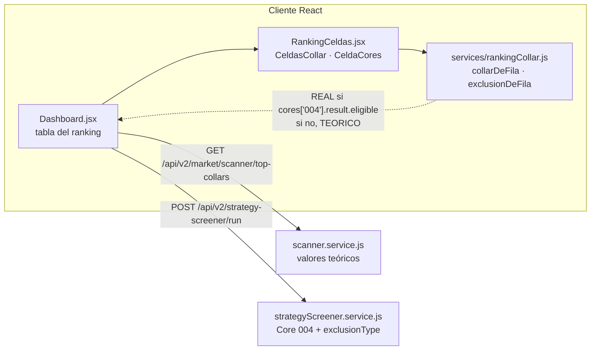

# REPORT-DrFIC — `core-004-en-ranking`

## Resumen ejecutivo

El profesor pidió ver el resultado del Core 004 (estrategias) en la tabla del ranking. Antes, las columnas de collar mostraban siempre el escáner teórico de Black-Scholes.

Ahora, después de evaluar los cores, cada empresa apta muestra en esas columnas el collar real del Core 004:

- contratos con su vencimiento;
- `ask` del Put y `bid` del Call;
- costo neto como débito o crédito;
- retorno máximo;
- la marca «Real · Core 004» con la hora de cotización.

En esas filas la probabilidad N(d₂) dice «No aplica». Antes de evaluar, y en las filas sin collar del 004 (ETFs y empresas excluidas), las columnas muestran el escáner con la marca «Teórico · escáner».

La columna de cores ya no dice «Veto Cores» para cualquier exclusión. Distingue veto de viabilidad, sin collar líquido y datos insuficientes, con su causa, gracias al nuevo `exclusionType` de la API.

Con datos reales del 2026-11-20 la diferencia es grande: para AAPL el escáner teórico mostraba un crédito de $1.69 por acción, y el collar observado es un débito de $4.00.

## Atribución

| Trabajo | Autoría |
|---|---|
| Pruebas, implementación, verificación y este reporte | Asistido por IA (Claude Code), a solicitud de Eddie Altamirano |
| Revisión humana del resultado | Pendiente |
| Optimización manual acreditada | Ninguna en este change |

## Diagrama C4 (nivel de componentes)

## Lógica integrada

- **Backend**: `exclusionType` se asigna en el mismo punto donde se decide el motivo de exclusión:

  | Caso | `exclusionType` |
  |---|---|
  | Veto de viabilidad | `VIABILITY_VETO` |
  | Viabilidad, eventos o cadena sin datos | `INSUFFICIENT_DATA` |
  | Core 004 sin par elegible | `NO_COLLAR` |
  | Core seleccionado sin puntaje | `INSUFFICIENT_DATA` |

  Los candidatos no llevan el campo.
- **Mapeo** (`collarDeFila`):
  - **REAL**: el Core 004 tiene `eligible: true`.
    - Primas: `ask` del Put y `bid` del Call.
    - Costo: `netPremiumPerShare` positivo es débito.
    - Retorno: `maxProfit / (underlyingPrice × shares)`, la misma definición que el escáner.
    - Hora: la de la cotización más antigua de las dos patas, en hora del Este.
  - **TEORICO**: en cualquier otro caso.
    - Costo: `netDebitCredit` del escáner, donde positivo es crédito.
    - La prima teórica se lee en un solo lugar (`theoreticalPremium ?? marketPremium`), lista para el renombre de `escaner-sin-precios-fijos`.
- **Tabla**:
  - `Dashboard.jsx` solo pinta lo que devuelven `CeldasCollar` y `CeldaCores`, y conserva las mismas columnas.
  - El selector de orden ahora dice «N(d₂) teórica», porque el orden por probabilidad sigue usando el escáner.

## Registro de tareas

Los tiempos son las fechas de modificación reales de los archivos de cada tarea (UTC−07:00).

| Tarea | Archivo | Momento |
|---|---|---|
| 1.1 Vitest, React Testing Library y jsdom (agregados en `graficas-de-cores`) | `client/package.json` | 2026-11-20 19:02 |
| 1.2 Prueba backend de `exclusionType` (fase roja confirmada) | `test/strategyScreener.v2.test.js` | 2026-11-20 19:56:51 |
| 2.1 `exclusionType` en el orquestador | `strategyScreener.service.js` | 2026-11-20 19:56:59 |
| 1.2 Pruebas del mapeo y de las celdas (fase roja confirmada) | `rankingCollar.spec.js`, `RankingCeldas.spec.jsx` | 2026-11-20 19:57:52 |
| 2.2 Módulo de mapeo | `client/src/services/rankingCollar.js` | 2026-11-20 19:58:02 |
| 2.3 Celdas del ranking | `RankingCeldas.jsx` | 2026-11-20 19:58:19 |
| 2.3 Uso en la tabla | `Dashboard.jsx` | 2026-11-20 19:58:30 |
| 3.1 OpenAPI y Postman | `spec/openspec.yaml` y colecciones | 2026-11-20 19:58:46 |
| 3.1 Documento de cores (sección 4.5) | `docs/EXPLICACION_CORES_Y_RANKING.md` | 2026-11-20 19:59:00 |
| 3.2 Pruebas de calidad de API | `docs/evidencias-pruebas-api/resultados.json` | 2026-11-20 20:00:08 |

## Verificación

- **`npm test` (backend)**: 101 de 101, incluida la prueba de veto, sin collar y datos insuficientes.
- **`npm run test:api-quality`**: `RESULTADO PASS: 99 pruebas aprobadas, 0 fallidas`. Los 5 hallazgos de seguridad y monitoreo que registra ya existían y no se relacionan con este change.
- **`npm test` (cliente)**: 39 de 39, con estos casos:
  - collar real con débito, retorno y hora;
  - crédito y costo cero;
  - teórico sin cores o sin collar;
  - signos de ambos orígenes;
  - etiquetas de exclusión;
  - celdas de las filas real, teórica, excluida sin collar y apta.
- **`npm run build`**: correcto.
- **Datos reales** (escáner y screener del 2026-11-21, 02:59Z; 10 empresas):
  - Con collar real: AAPL, MSFT, GOOGL, META, NVDA y TSLA.
  - AMZN y AMD: `INSUFFICIENT_DATA`, «Cobertura contable insuficiente para un puntaje comparable».
  - SPY y QQQ: teóricos, «Benchmark ETF».
- **Revisión visual**: se hizo en Chrome sin interfaz, con una página auxiliar que monta `CeldasCollar` y `CeldaCores` reales con esas respuestas, antes y después de evaluar, en escritorio y móvil (390 px, diseño de tarjetas existente). Falta revisar el Dashboard completo con sesión iniciada.

## Riesgos de integración por etapa

| Etapa | Riesgo | Mitigación |
|---|---|---|
| API | Backend sin `exclusionType` (Render en `main`) | La celda muestra «Excluida» con la causa |
| Mapeo | Signos opuestos entre el escáner y el Core 004 | Se normaliza a «Débito», «Crédito» o «Costo cero»; hay pruebas de ambos signos |
| Tabla | El orden por probabilidad usa el valor teórico | El selector dice «N(d₂) teórica» y la celda real dice «No aplica» con la explicación |
| Tabla | Las cotizaciones del 004 pueden ser del cierre | Se muestra la hora real de la cotización más antigua |
| Coordinación | Renombre `marketPremium` → `theoreticalPremium` | La lectura está en un solo lugar del mapeo |
| Fuera de alcance | La cabecera del activo y el Auto-Collar de la columna derecha siguen usando el escáner | Planeado en `ejecucion-de-coberturas-multipata` y `panel-de-ordenes-con-datos-reales` |

## Pendientes, sin marcar como hechos

- Revisión humana del código y de este reporte.
- Revisión del Dashboard completo con sesión real.
- Commit y despliegue, que solo se hacen con instrucción explícita. El usuario pidió mantener todo en local por ahora.
