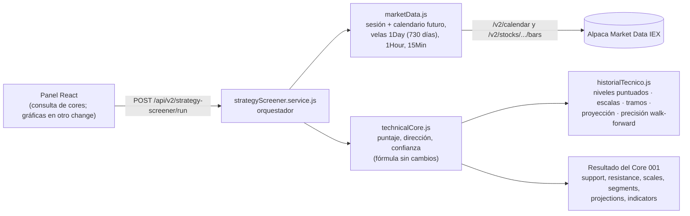

# REPORT-DrFIC — `core-tecnico-historico-dos-anios`

## Resumen ejecutivo

El Core 001 ahora analiza **dos años de velas diarias**. Sobre esa serie:

- calcula **soportes y resistencias puntuados**;
- reporta la **tendencia en tres escalas, con su fecha de confirmación**, y los tramos de tendencia;
- proyecta una **ventana de fechas** para el posible cruce de medias, en lugar de un día exacto, junto con la **precisión que ese método tuvo en el histórico**.

Esto responde a la observación del profesor ("técnico es indicadores"; soportes, resistencias y tendencias con dos años; qué día se proyecta una tendencia), en la forma acordada con él: fecha de confirmación más una ventana con precisión medida. La proyección es informativa: **no cambia el puntaje del Core 001 ni la confluencia**.

## Atribución

| Trabajo | Autoría |
|---|---|
| Diseño de los artefactos, pruebas, implementación, verificación y este reporte | Asistido por IA (Claude Code), a solicitud de Eddie Altamirano |
| Revisión humana del resultado | Pendiente |
| Optimización manual acreditada | Ninguna en este change |

## Diagrama C4 (nivel de componentes)

## Lógica integrada

- **Datos**: `obtenerHistorialVelas` pide 730 días de velas diarias, unas 500 sesiones. `obtenerSesionBursatil` ahora consulta el calendario de Alpaca hasta 130 días hacia adelante y expone las sesiones futuras (`upcoming`), que se usan para fechar las ventanas proyectadas sin suponer días hábiles.
- **Niveles**:
  - Se toman pivotes fractales con 2 velas por lado.
  - Se agrupan con una tolerancia de `max(0.35·ATR, 0.2 % del precio)` y solo dentro de ±20 % del cierre.
  - El puntaje pondera toques (40 %, con tope de 5), antigüedad (25 %, vida media de 120 sesiones), volumen relativo (20 %) y proximidad (15 %).
  - Se reportan los 3 mejores de cada lado.
- **Escalas**:
  - Primaria: precio frente a la SMA200 y pendiente de la SMA200.
  - Intermedia: EMA50 frente a la SMA200.
  - Corta: EMA20 frente a la EMA50, válida solo si el ADX es mayor o igual a 20.
  - Un cambio de estado se confirma cuando se mantiene 3 sesiones, y se fecha desde su primera sesión.
  - Los tramos de menos de 10 sesiones se fusionan con el vecino.
  - Con menos de 220 velas, las escalas que usan la SMA200 se informan como no disponibles.
- **Proyección**:
  - Se ajusta una regresión lineal a los últimos 20 valores de la diferencia entre las medias.
  - Si las medias convergen, la ventana es `|d / pendiente|` con ±1.96 errores estándar, dentro de un horizonte de 60 sesiones.
  - Si no convergen o el cruce queda fuera del horizonte, se indica la causa.
- **Precisión**: para cada cruce real se toma la primera proyección de su régimen y se reportan el porcentaje de acierto de la ventana, el error medio en sesiones y el número de casos. Con menos de 3 casos se marca como muestra insuficiente.
- **Indicadores**:
  - RSI(14) con su zona.
  - MACD(12,26,9) con línea, señal, histograma y último cruce con fecha.
  - ADX(14) con ±DI y su clase.
  - Bollinger(20,2).
- **Helpers**: `clamp`, `round`, `mean` y `smooth` pasaron a `historialTecnico.js`. `technicalCore.js` reexporta `clamp` y `round`, así que los demás cores no cambian.

## Registro de tareas

Los tiempos son las fechas de modificación reales de los archivos de cada tarea (UTC−07:00).

| Tarea | Archivo | Momento |
|---|---|---|
| 1.1–1.2 Series de prueba y pruebas que fallan | `test/helpers/seriesTecnicas.js` | 2026-11-20 18:48:04 |
| 1.1–1.3 Pruebas (fase roja confirmada: falta el módulo) | `test/technicalCore.historico.test.js` | 2026-11-20 18:49:11 |
| 2.2–2.3 Niveles, escalas, tramos, proyección y precisión | `historialTecnico.js` | 2026-11-20 18:51:15 |
| 2.4 Lectura de indicadores e integración | `technicalCore.js` | 2026-11-20 18:51:41 |
| 2.1 Ventana de dos años y calendario futuro | `marketData.js` | 2026-11-20 18:52:16 |
| 3.1 Verificación con datos reales | salida del script de verificación | 2026-11-20 18:52:43 |
| 3.1 Postman (Render y Cloudflare) | colecciones `.json` | 2026-11-20 18:53:30 |
| 3.1 OpenAPI (`TechnicalCoreResult`) | `spec/openspec.yaml` | 2026-11-20 18:53:45 |
| 3.1 Documento de cores | `docs/EXPLICACION_CORES_Y_RANKING.md` | 2026-11-20 18:54:08 |
| 3.2 Pruebas de calidad de API | `docs/evidencias-pruebas-api/resultados.json` | 2026-11-20 18:54:36 |

## Verificación

- **`node --test test/technicalCore.historico.test.js`**: 9 de 9. Junto con las pruebas del screener y de observaciones, 18 de 18.
- **`npm test`**: 95 de 95, 0 fallas.
- **`npm run test:api-quality`**: `RESULTADO PASS: 93 pruebas aprobadas, 0 fallidas`, con carga de hasta 100 conexiones concurrentes sin errores. Los hallazgos de seguridad y monitoreo que registra ya existían y no se relacionan con este change.
- **Datos reales** (Alpaca IEX, corte 2026-11-21T01:52Z; última sesión cerrada 2026-11-20; 86 sesiones futuras en el calendario):

| Símbolo | Velas | Escalas (desde) | Proyección corta | Precisión corta |
|---|---|---|---|---|
| AAPL | 501 | Primaria UP (2025-10-09), intermedia UP (2025-09-11), corta SIDEWAYS (2026-11-02) | Fuera del horizonte de 60 sesiones | 5 casos, 60 %, error medio de 9.8 sesiones |
| MSFT | 501 | Primaria UP (2026-09-18), intermedia UP (2026-08-17), corta SIDEWAYS (2026-11-09) | DOWN, del 2026-11-30 al 2026-12-03 | 4 casos, 25 %, error medio de 28.4 sesiones |
| NVDA | 501 | Primaria SIDEWAYS (2026-11-04), intermedia DOWN (2026-11-17), corta DOWN (2026-11-02) | Las medias se separan | 9 casos, 44 %, error medio de 18.4 sesiones |

La precisión real, de entre 25 % y 60 %, respalda la decisión de mostrar la proyección como una ventana informativa y no como una fecha ni como parte del puntaje.

## Riesgos de integración por etapa

| Etapa | Riesgo | Mitigación |
|---|---|---|
| Datos | El volumen de IEX es solo parte del consolidado | Se usa como volumen relativo y se declara en `limitation` |
| Datos | La consulta del calendario a futuro depende de Alpaca | Si no hay fechas suficientes, se informa `windowReason` en lugar de inventar fechas |
| Cálculo | Hay pocos cruces en dos años | Se reportan `cases` y `insufficientSample` |
| Respuesta | La respuesta del ranking crece | Se envían 3 niveles por lado y tramos resumidos; la serie completa irá en el endpoint de `graficas-de-cores` |
| Interfaz | El panel todavía no muestra los campos nuevos | Llegan con `detalle-de-cores-en-modal` y `graficas-de-cores` |

## Pendientes, sin marcar como hechos

- Revisión humana del código y de este reporte.
- Verificar los campos nuevos en la interfaz, lo que depende de los changes del modal y de las gráficas.
- Commit y despliegue, que solo se hacen con instrucción explícita.
