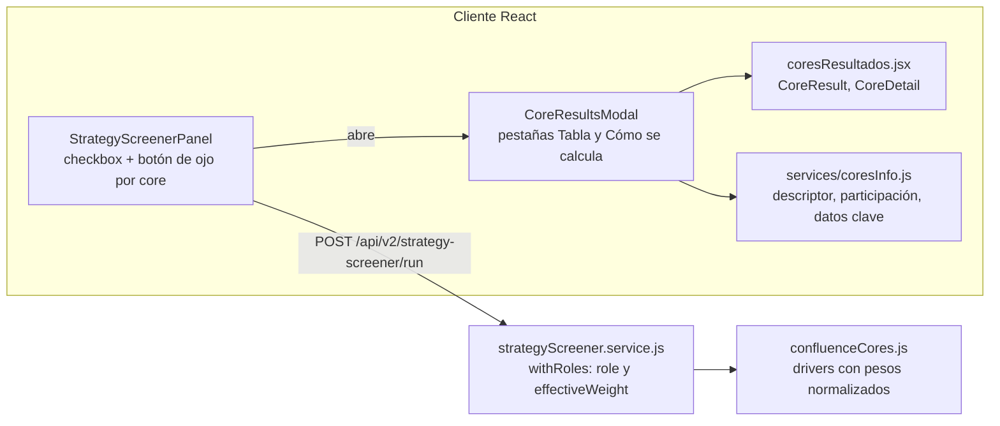

# REPORT-DrFIC — `detalle-de-cores-en-modal`

## Resumen ejecutivo

Cada core del selector tiene ahora un botón con ícono de ojo, separado del checkbox, que abre una consulta en un modal. Lo pidió el profesor: ver los resultados de los cores sin saturar la interfaz. El modal tiene dos pestañas:

- **Tabla**: una fila por empresa evaluada, con estado, puntaje, participación y datos clave. Cada fila se expande para mostrar sus métricas y evidencia.
- **Cómo se calcula**: fuentes, ventanas de datos, cálculo, peso y forma de participar.

Antes de evaluar, el modal solo muestra «Cómo se calcula», con el aviso de evaluar para ver resultados.

Para que la participación no se infiera en el cliente, la API agrega a cada core su `role` (`CONFLUENCE`, `GATE`, `DEPENDENCY`, `SYNTHESIS` o `NOT_COMPUTED`) y, cuando el core entra a la confluencia, su `effectiveWeight`. También se agregaron filas sin checkbox para Estrategia (004, «Siempre activo») y Confluencia (007, «Resultado»).

## Atribución

| Trabajo | Autoría |
|---|---|
| Pruebas, implementación, verificación y este reporte | Asistido por IA (Claude Code), a solicitud de Eddie Altamirano |
| Revisión humana del resultado | Pendiente |
| Optimización manual acreditada | Ninguna en este change |

## Diagrama C4 (nivel de componentes)

## Lógica integrada

- **Backend**: `withRoles` se aplica a cada empresa después de calcular la confluencia.
  - 007 → `SYNTHESIS`.
  - 004 → `GATE` si se consultó su cadena de opciones; si no (por veto o por viabilidad sin verificar), `NOT_COMPUTED`.
  - Core seleccionado → `CONFLUENCE`, con `effectiveWeight` tomado de los `drivers` de la confluencia (4 decimales), solo cuando la confluencia tiene puntaje.
  - 002 no seleccionado → `GATE` (veto de viabilidad).
  - Otro core no seleccionado → `DEPENDENCY` si se calculó (001 para 003); si no, `NOT_COMPUTED`.
  - Se crean objetos nuevos por core, así que los diagnósticos guardados en la caché de 90 s no se modifican.
- **Cliente**:
  - El botón queda fuera del `<label>` del checkbox, así que pulsarlo no cambia la selección.
  - El modal usa el mismo estado del panel (cargando, error o datos), que es lo que recibe el Dashboard.
  - `CoreResult` y `CoreDetail` se movieron a `coresResultados.jsx`. Se eliminaron la rama `hideAssetList = false`, el componente `Asset` y la prop en el Dashboard.
  - Accesibilidad:
    - el modal es un `role="dialog"` con `aria-modal`;
    - el foco va al botón de cerrar, queda atrapado dentro del modal y vuelve al ojo al cerrar;
    - se cierra con Esc;
    - las pestañas usan `role="tab"`.
  - En móvil el modal ocupa toda la pantalla y la tabla se desplaza en horizontal.
- **Descriptor**: `CORES_INFO` resume cada core según `docs/EXPLICACION_CORES_Y_RANKING.md`, que ahora tiene una sección 4.4 sobre la participación.

## Registro de tareas

Los tiempos son las fechas de modificación reales de los archivos de cada tarea (UTC−07:00).

| Tarea | Archivo | Momento |
|---|---|---|
| 1.1 Prueba backend de `role` y `effectiveWeight` (fase roja confirmada) | `test/strategyScreener.v2.test.js` | 2026-11-20 19:21:38 |
| 2.1 `withRoles` en el orquestador | `strategyScreener.service.js` | 2026-11-20 19:21:48 |
| 1.2 Datos de prueba y pruebas del descriptor (fase roja confirmada) | `__fixtures__/screener.js`, `coresInfo.spec.js` | 2026-11-20 19:22:56 |
| 2.2 Descriptor y textos de participación | `client/src/services/coresInfo.js` | 2026-11-20 19:23:27 |
| 2.2 Módulo propio de `CoreResult` y `CoreDetail` | `coresResultados.jsx` | 2026-11-20 19:23:41 |
| 2.4 Modal con pestañas | `CoreResultsModal.jsx` | 2026-11-20 19:24:37 |
| 2.3 y 2.5 Botones, filas 004 y 007, y eliminación de la rama sin uso | `StrategyScreenerPanel.jsx`, `Dashboard.jsx` | 2026-11-20 19:25:00 |
| 1.2 Pruebas de componente en sus cuatro estados | `StrategyScreenerPanel.spec.jsx` | 2026-11-20 19:25:07 |
| 3.2 Verificación con datos reales | respuesta real del screener y capturas | 2026-11-20 19:25:25 – 19:25:39 |
| 3.1 OpenAPI y Postman | `spec/openspec.yaml` y colecciones | 2026-11-20 19:26:06 |
| 3.1 Documento de cores (sección 4.4) | `docs/EXPLICACION_CORES_Y_RANKING.md` | 2026-11-20 19:26:19 |
| 3.2 Pruebas de calidad de API | `docs/evidencias-pruebas-api/resultados.json` | 2026-11-20 19:26:34 |

## Verificación

- **`npm test` (backend)**: 100 de 100, incluida la prueba nueva de participación (selección completa, solo 003 y empresa vetada).
- **`npm run test:api-quality`**: `RESULTADO PASS: 98 pruebas aprobadas, 0 fallidas`. Los 5 hallazgos de seguridad y monitoreo que registra ya existían y no se relacionan con este change.
- **`npm test` (cliente, Vitest)**: 19 de 19.
  - Las del modal cubren sin evaluar (solo «Cómo se calcula»), cargando, error con la causa, y con datos (tabla, evidencia, cambio de pestaña, cierre con Esc y retorno del foco).
  - También comprueban que el ojo no cambia la selección y que 004 y 007 no tienen checkbox.
- **`npm run build`**: correcto. La librería de gráficas sigue en su propio chunk.
- **Datos reales** (Alpaca, SEC EDGAR y Webull; corte 2026-11-21T02:25:22Z, análisis `PARTIAL`, 6 candidatos y 2 excluidas):
  - Con los cinco cores: 001 `CONFLUENCE` 0.225, 002 0.25, 003 0.15, 005 0.1875 y 006 0.1875; 004 `GATE`; 007 `SYNTHESIS`.
  - Solo 003: 001 `DEPENDENCY`, 002 `GATE`, 003 `CONFLUENCE` 1, 005 y 006 `NOT_COMPUTED`.
  - AMZN y AMD quedaron excluidas porque algún core seleccionado no tuvo puntaje: muestran «Seleccionado, sin puntaje combinado» y 004 `NOT_COMPUTED` («Viabilidad de la empresa sin verificar»).
- **Revisión visual**: se hizo en Chrome sin interfaz, con una página auxiliar que monta el panel real con esa respuesta: Técnico con la evidencia de AAPL expandida, Estrategia, Fundamental en móvil (390 px) e Institucional sin evaluar. Falta revisarlo en el Dashboard con sesión iniciada.

## Riesgos de integración por etapa

| Etapa | Riesgo | Mitigación |
|---|---|---|
| API | Un backend sin `role` (Render en `main`) | El cliente muestra «Sin dato de participación (versión anterior de la API)» |
| API | La respuesta crece | Solo se agregan dos campos por core |
| Interfaz | El ojo se confunde con activar o desactivar el core | El botón está fuera del label, con tooltip y `aria-label`; hay una prueba de que no cambia la selección |
| Interfaz | Tabla ancha en móvil | Modal a pantalla completa con desplazamiento horizontal; la evidencia se ve al expandir la fila |
| Contenido | El descriptor se desalinea del cálculo | Comentario en `coresInfo.js` que pide actualizar el documento a la vez |

## Pendientes, sin marcar como hechos

- Revisión humana del código y de este reporte.
- Revisión en el Dashboard con sesión real.
- Commit y despliegue, que solo se hacen con instrucción explícita.
