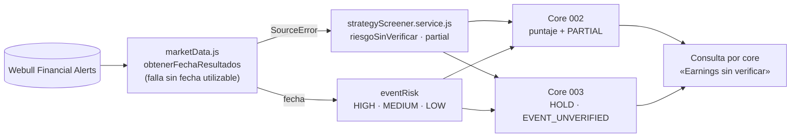

# REPORT-DrFIC — `earnings-sin-verificar`

## Resumen ejecutivo

Cuando Webull no entrega la fecha de resultados, el sistema ya no inventa una a +60 días atribuida a «Financial Alerts (Estimado)». Esa fecha dejaba el riesgo en `LOW` y el Core 003 nunca aplicaba la regla de earnings. Ahora:

- el riesgo de eventos queda `UNVERIFIED`, con la causa y sin evidencia del calendario;
- el Core 002 conserva su puntaje como parcial;
- el Core 003 se abstiene con `HOLD` y `EVENT_UNVERIFIED`;
- la empresa conserva su posición, marcada como parcial;
- la consulta por core muestra «Earnings sin verificar» con la causa.

En la corrida real de este change, el calendario no respondió para GOOGL y el caso se manejó así: quedó en el puesto #6, como parcial y sin fecha inventada.

## Atribución

| Trabajo | Autoría |
|---|---|
| Pruebas, implementación, documento, contrato, verificación y este reporte | Asistido por IA (Claude Code), a solicitud de Eddie Altamirano |
| Revisión humana | Pendiente |

## Diagrama C4 (nivel de componentes)

## Lógica integrada

- **`obtenerFechaResultados`**: lanza `SourceError` si Webull no responde o no entrega una ventana utilizable (dentro de −1 a +180 días y con fin posterior al inicio). Así funcionaba en `11be956`.
- **`riesgoSinVerificar(causa, fuente)`**: devuelve `risk: 'UNVERIFIED'` con la causa y la fuente consultada, fechas en `null` y sin evidencia.
- **Core 002**: con el riesgo sin verificar devuelve `PARTIAL` y conserva su puntaje y su señal, porque el puntaje no usa los eventos. Antes quedaba sin puntaje y la empresa salía del ranking.
- **Core 003**: se abstiene con `HOLD`, `EVENT_UNVERIFIED`, puntaje neutral 65 y confianza 0.50, como `INSUFFICIENT_CONFIRMATION`. Queda `PARTIAL`.
- **Orquestador**: la fila ya no se excluye por falta de fecha. Se marca como incompleta, así que la respuesta es `PARTIAL`. Los candidatos traen `partial`.
- **Cliente**: `riesgoDeEvento` traduce `UNVERIFIED` a «Earnings sin verificar». El 002 muestra la causa en lugar de «Próximos resultados». Los datos clave de la fila agregan «· Earnings sin verificar».

## Registro de tareas

Los tiempos son las fechas de modificación reales de los archivos de cada tarea (UTC−07:00).

| Tarea | Archivo | Momento |
|---|---|---|
| 1.1 Pruebas backend (fase roja: 2 fallidas) | `test/strategyScreener.v2.test.js` | 2026-11-20 23:22 |
| 1.2 Prueba de componente (fase roja: 2 fallidas) | `EarningsSinVerificar.spec.jsx` | 2026-11-20 23:23 |
| 2.1–2.2 Calendario, riesgo, cores y orquestador | `marketData.js`, `fundamentalCore.js`, `technicalCore.js`, `strategyScreener.service.js` | 2026-11-20 23:23 |
| 2.3 Etiqueta en la consulta por core | `coresResultados.jsx`, `coresInfo.js` | 2026-11-20 23:24 |
| 3.1 Documento de cores, OpenAPI y Postman | `EXPLICACION_CORES_Y_RANKING.md`, `spec/openspec.yaml` | 2026-11-20 23:24 |
| 3.2 Pruebas de calidad y corrida real | `resultados.json` | 2026-11-20 23:24 |

## Verificación

- **`npm test`**: 117 de 117, con 2 pruebas nuevas:
  - Calendario caído: la empresa conserva su posición con `UNVERIFIED`; el 003 da `HOLD`/`EVENT_UNVERIFIED`; la respuesta es `PARTIAL`; no hay evidencia del calendario. Con fecha, el riesgo vuelve a `LOW`.
  - `obtenerFechaResultados` falla sin fecha y no atribuye «(Estimado)».
- **Vitest**: 41 de 41, con 2 pruebas nuevas de la etiqueta en Fundamental y Señales directas. El build es correcto.
- **`npm run test:api-quality`**: `RESULTADO PASS: 115 pruebas aprobadas, 0 fallidas`. Los 5 hallazgos ya existían.
- **Corrida real** (2026-11-21T06:24Z, cinco cores):

  | Empresa | Resultado |
  |---|---|
  | AAPL, META, MSFT, NVDA y TSLA | Fecha de Webull y riesgo `LOW` (por ejemplo, AAPL 2027-01-27) |
  | GOOGL | «El calendario de resultados no respondió: La fuente no respondió con datos válidos en el tiempo disponible» → `UNVERIFIED`; 003 `EVENT_UNVERIFIED`; puesto #6 con `partial: true` |
  | AMZN y AMD | Fecha real; siguen excluidas por cobertura contable |

## Riesgos de integración por etapa

| Etapa | Riesgo | Mitigación |
|---|---|---|
| API | Más respuestas `PARTIAL` si Webull falla seguido | Se ven como parciales con la causa; el ranking no se vacía |
| Clientes | Aparecen `UNVERIFIED`, `EVENT_UNVERIFIED` y `partial` | Son campos y valores nuevos; documentados en OpenAPI y Postman |
| Confluencia | El 003 aporta 65 neutral cuando se abstiene | Igual que `INSUFFICIENT_CONFIRMATION`; está documentado |

## Pendientes, sin marcar como hechos

- Revisión humana.
- Commit y despliegue, solo con instrucción explícita (todo en local).
