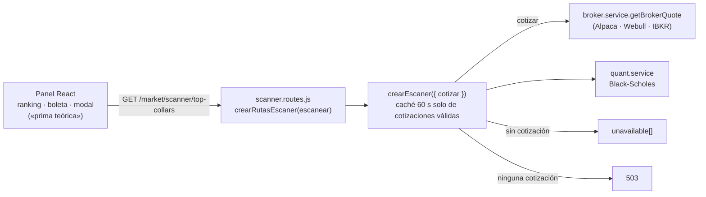

# REPORT-DrFIC — `escaner-sin-precios-fijos`

## Resumen ejecutivo

`top-collars` ya no inventa precios ni lecturas técnicas:

- **Precios de referencia retirados**: antes, si el broker fallaba o tardaba más de 600 ms, el escáner usaba en silencio un precio de referencia (AAPL a $227.50), y $100 para los tickers añadidos. Ahora un activo sin cotización va a `unavailable` con el motivo del broker. Si ninguno cotiza, responde `503`.
- **Primas teóricas**: se llaman `theoreticalPremium` (BREAKING; antes `marketPremium`) y son el precio Black-Scholes sin el ajuste inventado de ×1.02/×0.98. Cada candidato trae `pricing` con el modelo, la volatilidad supuesta y su origen, y la tasa.
- **Lecturas técnicas retiradas**: salen `technicalOutlook`, `technicalSummary`, `rsi14` y `aboveSma200`, que salían de valores fijos en el código.
- **Panel**: rotula las primas del escáner como teóricas en la boleta y el modal (el ranking ya lo hacía), y distingue la prima enviada en una orden.

## Atribución

| Trabajo | Autoría |
|---|---|
| Pruebas, implementación, contrato, documento, verificación y este reporte | Asistido por IA (Claude Code), a solicitud de Eddie Altamirano |
| Revisión humana | Pendiente |

## Diagrama C4 (nivel de componentes)

## Lógica integrada

- **`crearEscaner({ cotizar, limiteMs })`**:
  - Recibe el proveedor de cotizaciones; por defecto es `getBrokerQuote`, y las pruebas inyectan uno sin red.
  - Se eliminaron la rama `NODE_ENV === 'test'` (que nunca se activaba en `npm test`), `getCachedOrBrokerSpot` y el respaldo a `referenceSpot`.
  - El límite por cotización subió de 600 ms a 3 s.
- **Tickers añadidos**:
  - Sin cotización van a `unavailable`.
  - Con cotización usan una volatilidad declarada de 0.28, informada como tal en `pricing.volatilitySource`.
  - Ya no tienen nombre de empresa inventado («X Inc.»); queda en `null` si el broker no lo entrega.
- **Rutas**: `crearRutasEscaner(escanear)` permite montar el escáner con un proveedor de prueba. La app usa el predeterminado.
- **Cliente**: `BrokerExecutionModal` y `Dashboard` usan `theoreticalPremium` y los rótulos «Prima teórica (escáner)» o «Prima enviada». El mapeo del ranking (`rankingCollar.js`) conserva la lectura de `marketPremium` solo para backends anteriores.

## Registro de tareas

Los tiempos son las fechas de modificación reales de los archivos de cada tarea (UTC−07:00).

| Tarea | Archivo | Momento |
|---|---|---|
| 1.1 Pruebas con proveedor de prueba (fase roja: falta `crearEscaner`) | `test/scanner.v2.test.js` | 2026-11-20 23:26 |
| 2.1–2.3 Escáner inyectable, `unavailable`, `503`, campos teóricos | `scanner.service.js`, `scanner.routes.js`, `scanner.controller.js` | 2026-11-20 23:27:01 |
| 1.1 Caché aislada por prueba y prueba directa de la caché | `test/scanner.v2.test.js` | 2026-11-20 23:27:12 |
| 2.4 Prueba del modal (fase roja) y rótulos en el cliente | `PrimasTeoricas.spec.jsx`, `BrokerExecutionModal.jsx`, `Dashboard.jsx` | 2026-11-20 23:27:57 |
| 3.1 OpenAPI, Postman y documento | `spec/openspec.yaml`, colecciones, `EXPLICACION_CORES_Y_RANKING.md` | 2026-11-20 23:28:34 |
| 3.2 Pruebas de calidad y corrida real | `resultados.json` | 2026-11-20 23:28:44 |

## Verificación

- **`npm test`**: 122 de 122. El archivo del escáner tiene 15 pruebas, entre ellas:
  - activo sin cotización en `unavailable` sin el precio 227.5;
  - `503` sin cotizaciones;
  - ticker añadido sin cotización (y con precio, `companyName` en `null`, volatilidad declarada);
  - `theoreticalPremium`, `pricing` y ausencia de los campos técnicos;
  - caché solo de cotizaciones válidas.
- **Vitest**: 43 de 43, con 2 pruebas del modal (primas teóricas y prima enviada). El build es correcto.
- **`npm run test:api-quality`**: `RESULTADO PASS: 120 pruebas aprobadas, 0 fallidas`. Los 5 hallazgos ya existían.
- **Corrida real** (2026-11-20 23:29 −07:00, canasta más `ZZZZQ`):

  | Broker | Candidatos | Primero | Sin cotización |
  |---|---|---|---|
  | Alpaca (329 ms) | 10 | SPY 693.89 | `ZZZZQ`: «Alpaca Markets rechazó la solicitud: no snapshot found for ZZZZQ» |
  | Webull (4.7 s) | 10 | SPY 689.81 | `ZZZZQ`: `INVALID_SYMBOL` de Webull |

  En ninguno de los dos se usó un precio de referencia.

## Riesgos de integración por etapa

| Etapa | Riesgo | Mitigación |
|---|---|---|
| Clientes externos | BREAKING: `marketPremium` → `theoreticalPremium`; sin `technicalOutlook` | Documentado en OpenAPI y Postman; el panel se actualizó en este mismo change |
| Broker lento | Más activos en `unavailable` | El motivo se informa; el límite es de 3 s y la caché guarda lo válido 60 s |
| Valores | Las primas teóricas bajan o suben unos centavos sin el ×1.02/×0.98 | El ajuste no tenía fuente; el collar real lo da el Core 004 |
| Fuera de alcance | La boleta y el Protective Put aún usan el candidato fabricado y la prima teórica como precio de orden | `panel-de-ordenes-con-datos-reales` y `ejecucion-de-coberturas-multipata` |

## Pendientes, sin marcar como hechos

- Revisión humana.
- Commit y despliegue, solo con instrucción explícita (todo en local).
