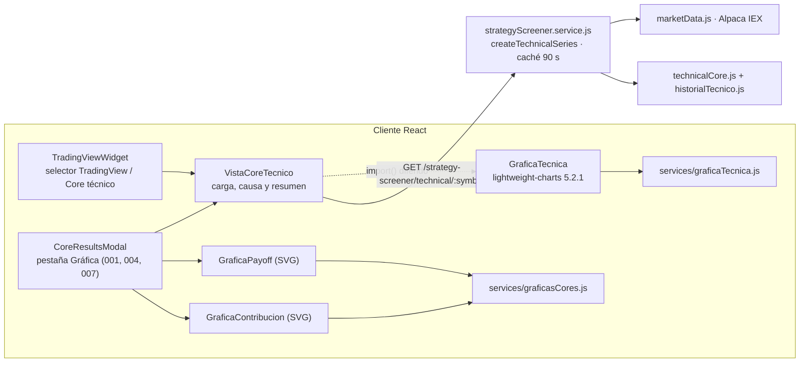

# REPORT-DrFIC — `graficas-de-cores`

## Resumen ejecutivo

El profesor pidió ver cada core en gráfica además de en tabla. Este change agrega gráficas solo donde aportan información:

- **Columna central**: un selector «TradingView / Core técnico». TradingView sigue siendo la vista por defecto. «Core técnico» dibuja el Core 001 del activo seleccionado:
  - velas diarias de dos años;
  - SMA200, EMA50 y EMA20;
  - bandas de soporte y resistencia (S1/R1… en el eje);
  - tramos de tendencia;
  - la ventana proyectada, rotulada como proyección.

  No requiere evaluar los cores.
- **Consulta por core** (el modal del ojo): una pestaña **Gráfica** para 001, 004 y 007, con un selector de empresa.
  - **001**: reutiliza la misma gráfica técnica.
  - **004**: payoff del collar al vencimiento, con strikes, punto de equilibrio, pérdida máxima y ganancia máxima.
  - **007**: contribución de cada core al puntaje (peso efectivo × puntaje) y los conflictos de sesgo.
- **Endpoint nuevo**: `GET /api/v2/strategy-screener/technical/:symbol`.

Cada gráfica tiene un resumen en texto. Sin datos, muestra la causa en lugar de una gráfica vacía.

## Atribución

| Trabajo | Autoría |
|---|---|
| Pruebas, implementación, verificación y este reporte | Asistido por IA (Claude Code), a solicitud de Eddie Altamirano |
| Revisión humana del resultado | Pendiente |
| Optimización manual acreditada | Ninguna en este change |

## Diagrama C4 (nivel de componentes)

## Lógica integrada

- **Endpoint**:
  - Reutiliza `obtenerSesionBursatil`, `obtenerHistorialVelas` y `technicalCore`, así que las velas y los cálculos son los mismos que en el ranking.
  - Agrega las medias alineadas (`mediasMoviles`) y la banda de cada nivel (`toleranciaNiveles`, la misma tolerancia con que se agruparon los toques).
  - Guarda lo exitoso 90 s y descarta los fallos.
  - Códigos: `401` sin sesión, `400` con símbolo inválido, y `503` con la causa (`SourceError`, tiempo agotado o Core 001 sin velas).
- **Gráfica técnica**:
  - Usa `lightweight-charts` con velas y líneas, y una primitiva propia que dibuja:
    - las bandas;
    - la ventana proyectada;
    - las franjas de tramos, arriba para no tapar el logo de atribución que exige la licencia.
  - Solo reserva sesiones futuras del calendario de Alpaca hasta el fin de la ventana.
  - La rueda del mouse y el arrastre vertical quedan libres para desplazar la página. Hay botones de periodo 6M/1A/2A.
- **Payoff (004)**: se calcula con los mismos insumos del Core 004 (precio, ask del Put, bid del Call y strikes):
  - base = precio + ask − bid;
  - pérdida máxima = (base − strike Put) × acciones;
  - ganancia máxima = (strike Call − base) × acciones.

  Las pruebas comparan estas métricas con las que reporta el core.
- **Contribución (007)**: peso efectivo × puntaje de cada `driver`. La suma coincide con el puntaje de confluencia (±0.01 por redondeo). Los conflictos se marcan por grupo.
- **Carga diferida**: cada gráfica es un chunk aparte y solo se descarga al abrir su vista o pestaña.
- **Tamaño de los SVG**: se dibujan al ancho real del contenedor (`useAnchoContenedor`), así el texto no se encoge en móvil.

## Registro de tareas

Los tiempos son las fechas de modificación reales de los archivos de cada tarea (UTC−07:00).

| Tarea | Archivo | Momento |
|---|---|---|
| 1.1 Pruebas del endpoint (fase roja: falta `createTechnicalSeries`) | `test/serieTecnica.test.js` | 2026-11-20 18:59:41 |
| 2.1 Endpoint y ruta | `strategyScreener.service.js`, `strategyScreener.routes.js` | 2026-11-20 19:00:45 |
| 1.2 Pruebas del selector y de la vista sin datos (fase roja) | `TradingViewWidget.spec.jsx`, `graficaTecnica.spec.js` | 2026-11-20 19:03 |
| 2.3 Selector en la columna central | `TradingViewWidget.jsx` | 2026-11-20 19:05:57 |
| 2.2 Gráfica técnica con carga diferida | `GraficaTecnica.jsx` | 2026-11-20 19:08:59 |
| 4.1 OpenAPI y Postman | `spec/openspec.yaml` y colecciones | 2026-11-20 19:12 |
| 1.2 Pruebas de payoff y contribución (fase roja: falta el módulo) | `graficasCores.spec.js` | 2026-11-20 19:51:27 |
| 1.2 Pruebas de la pestaña Gráfica | `CoreResultsModal.spec.jsx` | 2026-11-20 19:51:47 |
| 3.1 Funciones de payoff y contribución | `graficasCores.js` | 2026-11-20 19:52:03 |
| 3.2 Pestaña Gráfica en el modal | `CoreResultsModal.jsx`, `VistaCoreTecnico.jsx` | 2026-11-20 19:52:58 |
| 3.1 SVG al ancho real (ajuste tras la revisión en móvil) | `GraficaPayoff.jsx`, `GraficaContribucion.jsx`, `useAnchoContenedor.js` | 2026-11-20 19:54:52 |
| 4.2 Pruebas de calidad de API | `docs/evidencias-pruebas-api/resultados.json` | 2026-11-20 19:55:09 |

## Verificación

- **`npm test` (backend)**: 100 de 100, incluidas 4 pruebas del endpoint (contrato, `401`, `400`, `503` sin guardar el fallo y `503` por Core 001 sin velas).
- **`npm run test:api-quality`**: `RESULTADO PASS: 98 pruebas aprobadas, 0 fallidas`. Los 5 hallazgos de seguridad y monitoreo que registra ya existían y no se relacionan con este change.
- **`npm test` (cliente, Vitest 4.1.12)**: 30 de 30, entre ellas:
  - payoff igual al Core 004;
  - suma de contribuciones igual a la confluencia;
  - selector con TradingView por defecto, sincronización de activo y persistencia en la sesión;
  - vista sin datos que muestra la causa;
  - pestaña Gráfica solo en 001, 004 y 007, y solo después de evaluar.
- **`npm run build`**: cada gráfica queda en su propio chunk:

  | Chunk | Tamaño (gzip) |
  |---|---|
  | `GraficaTecnica` (lightweight-charts) | 57.8 kB |
  | `GraficaPayoff` | 1.2 kB |
  | `GraficaContribucion` | 0.9 kB |

  El bundle inicial no incluye la librería; crece unos kB por el selector, el modal y sus funciones.
- **Datos reales** (Alpaca, SEC EDGAR y Webull; cortes del 2026-11-21 a las 01:51Z y 02:25Z):
  - Serie técnica de AAPL, MSFT y NVDA: 501 velas cada una, del 2024-11-21 al 2026-11-20. MSFT tiene una ventana DOWN del 2026-11-30 al 2026-12-03. El símbolo `ZZZZZ` responde `503` con «Serie 1Day incompleta».
  - Collar de AAPL: Put 330 / Call 360, pérdida máxima 1,740, ganancia máxima 1,260 y equilibrio 347.40; coinciden con la tabla.
  - Confluencia de AAPL: 68.63 = 19.77 + 14.36 + 12.38 + 12.38 + 9.75.
- **Revisión visual**: se hizo en Chrome sin interfaz, con una página auxiliar que monta los componentes reales con esas respuestas, en escritorio (1280 px) y móvil (390 px).
  - Corrigió que el logo de atribución tapaba los tramos.
  - Corrigió el periodo 1A en móvil.
  - Corrigió el texto de los SVG, que se encogía a unos 6 px en móvil.
  - Falta revisarlo en el Dashboard con sesión iniciada.

## Riesgos de integración por etapa

| Etapa | Riesgo | Mitigación |
|---|---|---|
| API | Render (`main`) no tiene el endpoint | El cliente muestra «Este backend aún no publica la serie técnica del Core 001» |
| API | Respuesta de unos 98 kB por empresa | Se pide solo para la empresa elegida y se guarda 90 s |
| Bundle | Tamaño de la librería | Carga diferida y chunk propio |
| Interfaz | Gráfica distinta de la tabla | Ambas salen del mismo resultado; hay pruebas de payoff y de suma de contribuciones |
| Interfaz | Desplazamiento de la página atrapado por la gráfica | Rueda y arrastre vertical desactivados en la gráfica técnica |
| Licencia | lightweight-charts (Apache-2.0) exige atribución | Se mantiene el logo de TradingView (`attributionLogo` por defecto) |

## Pendientes, sin marcar como hechos

- Revisión humana del código y de este reporte.
- Revisión en el Dashboard con sesión real, en escritorio y móvil.
- Commit y despliegue, que solo se hacen con instrucción explícita. El usuario pidió mantener todo en local por ahora.
