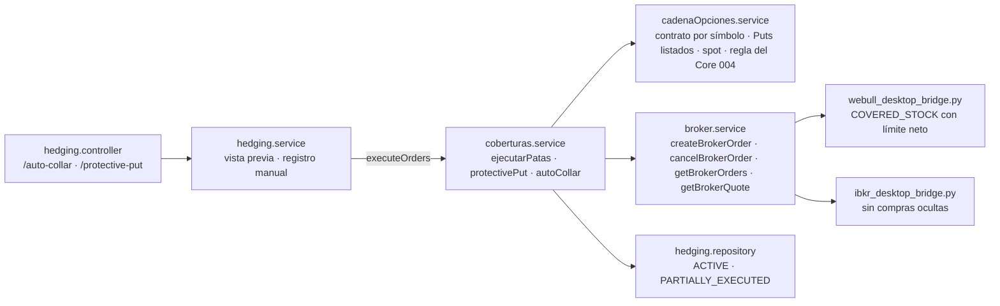

# REPORT-DrFIC — `ejecucion-de-coberturas-multipata`

## Resumen ejecutivo

El Protective Put y el Auto-Collar ahora envían sus patas con precios observados al momento de ejecutar: `ask` en las compras y `bid` en las ventas. Ya no usan la prima ni el spot del cliente, ni el precio guardado en la base. Además:

- **Orden de envío**: primero va el Put. Si una pata falla, se cancelan las pendientes y no se cierran las ejecutadas.
- **Resultado**:
  - `400` sin guardar, si nada quedó vivo;
  - `409` con la estrategia guardada como `PARTIALLY_EXECUTED`, si algo quedó vivo;
  - `201` si todas las patas quedaron en el broker.
- **Estados**: cada pata lleva el estado del broker. Ya no hay estados `submitted` por defecto ni ramas `SIM-`/`NODE_ENV`.
- **Auto-Collar**:
  - usa el collar del ranking (Core 004), cotizado de nuevo, o lo calcula sobre la cadena real;
  - exige `sharesCount` múltiplo de 100;
  - en Webull envía el `COVERED_STOCK` con el límite neto correcto.

### Dos riesgos de dinero real corregidos

| Riesgo | Antes | Ahora |
|---|---|---|
| Límite del `COVERED_STOCK` en Webull | Se enviaba el precio de las acciones como límite. `preview_option` muestra que el límite es el **neto por acción**, así que se aceptaba pagar hasta la prima completa del Call | Se envía el neto (acciones − bid del Call) |
| Compra oculta en IBKR | Al vender un Call, el bridge compraba acciones a mercado por su cuenta | Se retiró esa compra |

## Atribución: trabajo de IA y trabajo manual

| Trabajo | Autoría |
|---|---|
| Verificaciones 1.1 y 1.2, pruebas, implementación, contrato, ensayo en seco con datos reales y este reporte | Asistido por IA (Claude Code), a solicitud de Eddie Altamirano |
| Ejecutar `scripts/migrate_add_partial_status_supabase.sql` en Supabase | **Pendiente (manual)** |
| Verificación en la cuenta paper emitiendo un collar y un Protective Put | **Pendiente (manual)**: la IA no emitió órdenes reales |
| Revisión humana del código | Pendiente |

## Diagrama C4 (nivel de componentes)

## Lógica integrada

- **`ejecutarPatas`**:
  1. Envía las patas en orden y se detiene en la primera falla.
  2. Lee el libro de órdenes: estado, cantidad ejecutada y `verifiedInBroker` (`false` si la orden no aparece, sin estado inventado).
  3. Ante una falla, cancela las patas aceptadas que no tengan ejecución y vuelve a leer el libro.
  4. Una pata está viva si tiene ejecución o si su cancelación no se confirmó.
- **Respuestas**:
  - Sin patas aceptadas, se conserva el código del broker: `400` si rechazó y `503` si no respondió.
  - Con aceptadas canceladas con confirmación: `400` sin guardar.
  - Con patas vivas: `409` y se guarda `PARTIALLY_EXECUTED`.
  - Los errores incluyen `orders` y `failure`, y el `409` además `strategy`.
- **Protective Put**:
  - Usa el `contractSymbol` (verificado en Alpaca y cotizado en Webull) o el Put listado con el strike más cercano menor o igual al solicitado.
  - Compra `ceil(sharesCount / 100)` contratos.
  - Las acciones van al `ask` del broker seleccionado.
- **Auto-Collar**:
  - Si trae `putContractSymbol`/`callContractSymbol` (el collar del ranking), los vuelve a cotizar y verifica la liquidez del Core 004, el vencimiento, que sigan fuera del dinero y el costo base. Si no cumplen, `400` sin órdenes.
  - Sin esos contratos, calcula `elegirCollar` sobre la cadena real.
  - En Webull: Put y luego `COVERED_STOCK`. En Alpaca e IBKR: Put, acciones y Call.
- **Validación de órdenes**: el combo `COVERED_STOCK` se valida como débito (Buying Power) en `broker.service`.
- **Registro**:
  - Modelo con `PARTIALLY_EXECUTED` y, por pata, `orderStatus`, `filledQuantity`, `verifiedInBroker`, `accepted`, `brokerMessage` y `cancellation`. Supabase lo guarda en `legs_config`.
  - Los símbolos OCC usan el vencimiento real.
  - `/collar-spread` exige `putPremium`, `callPremium` y `expirationDate`, y ya no usa el spot de la base como respaldo.

## Verificaciones previas

- **1.1 Supabase**:
  - La raíz OpenAPI de PostgREST exige la clave de servicio (`401` con la clave anónima), así que no se pudo ver si `status` tiene una restricción. Solo se leyeron 101 filas, todas `ACTIVE`.
  - Se creó `scripts/migrate_add_partial_status_supabase.sql`. Es idempotente y sirve para tres casos: `TEXT` sin restricción, `CHECK` y `ENUM`.
  - Debe ejecutarse en el SQL Editor antes de desplegar.
- **1.2 Webull**: `preview_option` (sin emitir) de un `COVERED_STOCK` de AAPL (Call 360 del 2026-12-31) devolvió `estimated_cost = limit_price × 100`:

  | `limit_price` | `estimated_cost` |
  |---|---|
  | 343.40 | 34,340 |
  | 338.20 | 33,820 |

  Por eso el límite es el neto por acción del combo.

## Registro de tareas

Los tiempos son las fechas de modificación reales de los archivos de cada tarea (UTC−07:00).

| Tarea | Archivo | Momento |
|---|---|---|
| 1.1 Consulta a Supabase (solo lectura) y script de migración | `scripts/migrate_add_partial_status_supabase.sql` | 2026-11-20 23:30 |
| 1.2 `preview_option` de `COVERED_STOCK` (sin emitir) | salida en el scratchpad de la sesión | 2026-11-20 23:31 |
| 1.3 Pruebas `node:test` (fase roja: falta el módulo) | `test/coberturasMultipata.test.js` | 2026-11-20 23:32:35 |
| 2.2–2.4 Orquestador, Protective Put y Auto-Collar | `coberturas.service.js`, `cadenaOpciones.service.js` | 2026-11-20 23:34:25 |
| 2.1 y 2.5 Modelo, collar manual y registro fiel; bridges | `HedgingStrategy.model.js`, `hedging.service.js`, bridges | 2026-11-20 23:35:34 |
| 3.1 OpenAPI | `spec/openspec.yaml` | 2026-11-20 23:36:15 |
| 3.2 Pruebas de calidad y ensayo en seco | `resultados.json` | 2026-11-20 23:36:49 |

## Verificación

- **`npm test`**: 133 de 133. Incluye 11 pruebas nuevas con dobles de broker:
  - Put rechazado;
  - Put aceptado y acciones rechazadas, con cancelación confirmada (`400`) y rechazada (`409`);
  - pata ejecutada que no se cierra (`409`);
  - orden ausente del libro;
  - `sharesCount: 10`;
  - strike no listado y prima del cliente ignorada;
  - collar del ranking tal cual y ya no apto;
  - activo sin Core 004;
  - `COVERED_STOCK` con límite neto;
  - collar manual sin primas.
- **Bridges** (`unittest`): 9 de 9.
- **`npm run test:api-quality`**: `RESULTADO PASS: 131 pruebas aprobadas, 0 fallidas`. Los 5 hallazgos ya existían.
- **Ensayo en seco con datos reales** (2026-11-20 23:36 −07:00): cotizaciones, contratos y precio reales; envío, libro y guardado con dobles que no contactan al broker ni a la base.

  | Caso | Resultado |
  |---|---|
  | `sharesCount: 10` | `400` |
  | Collar del ranking en Webull (`AAPL261231P00330000` / `AAPL261231C00360000`) | Put al ask 9.20 y `COVERED_STOCK` con límite neto 339.80 (acciones 345 − Call 5.20); estrategia `ACTIVE` con pérdida máxima 1,900 |
  | Protective Put con strike 331 | Put listado de 330 al ask 9.20 y acciones al ask 345 |
  | Alpaca fuera de horario | `503` («no informó el ask de AAPL»), sin órdenes |

- **Coberturas reales en paper con curl** (2026-11-21, sábado; autorizado por el usuario, sin dobles de prueba). Cada orden se canceló después y cada estrategia se cerró:

  | Ruta | Broker / base | Resultado |
  |---|---|---|
  | `POST /api/v1/hedging/protective-put` con acciones | IBKR / MongoDB | `201`: Put 330 al ask 9.20 y 100 AAPL al ask 345, ambas aceptadas; estrategia `ACTIVE` |
  | `POST /api/v1/hedging/protective-put` sin acciones | Alpaca / Supabase | `201`: Put aceptado; estrategia `ACTIVE` |
  | `POST /api/v1/hedging/auto-collar` | IBKR / MongoDB | `201`: Put 330 comprado y Call 360 vendido (cubierto por las 300 AAPL en cartera) |
  | `POST /api/v1/hedging/auto-collar/AAPL` | IBKR / MongoDB | `201`, mismas patas |
  | `POST /api/v2/hedging/auto-collar` | IBKR / Supabase | `201`, mismas patas; guardada en Supabase |

  Webull no admite órdenes fuera de horario; su `COVERED_STOCK` ya se había confirmado con `preview_option` el 2026-11-20.
- **Corregido durante la verificación**: el panel enviaba `portfolioId: 'PORT-<símbolo>'`, que Supabase no puede guardar (`portfolio_id` es uuid). Como el guardado ocurre después de emitir, el collar habría quedado en el broker sin registro. Ahora el panel no envía portafolio y el servicio valida el `portfolioId` contra la base antes de emitir cualquier orden (prueba nueva en `coberturasMultipata.test.js`).

## Riesgos de integración por etapa

| Etapa | Riesgo | Mitigación |
|---|---|---|
| Base de datos | Si Supabase restringe `status`, `PARTIALLY_EXECUTED` no se guardaría | Ejecutar antes la migración idempotente |
| Panel | Aparecen `409` y `PARTIALLY_EXECUTED` | Los muestra `panel-de-ordenes-con-datos-reales` |
| Panel | El Protective Put del panel aún envía la prima del escáner | El backend la ignora como límite; el panel se corrige en `panel-de-ordenes-con-datos-reales` |
| Horario | Fuera de sesión Alpaca no informa `ask` | `503` sin órdenes; ejecutar en horario de mercado |
| Rollback | Los registros `PARTIALLY_EXECUTED` no caben en el enum anterior | Revisarlos o cerrarlos antes de revertir |
| Fuera de alcance | Cierre automático de patas ejecutadas y reconciliación posterior | Quedan para otro change |

## Pendientes, sin marcar como hechos

- Migración de Supabase: ejecutada por el usuario.
- Collar `COVERED_STOCK` de Webull emitido con mercado abierto.
- Revisión humana; commit y despliegue solo con instrucción explícita (todo en local).
