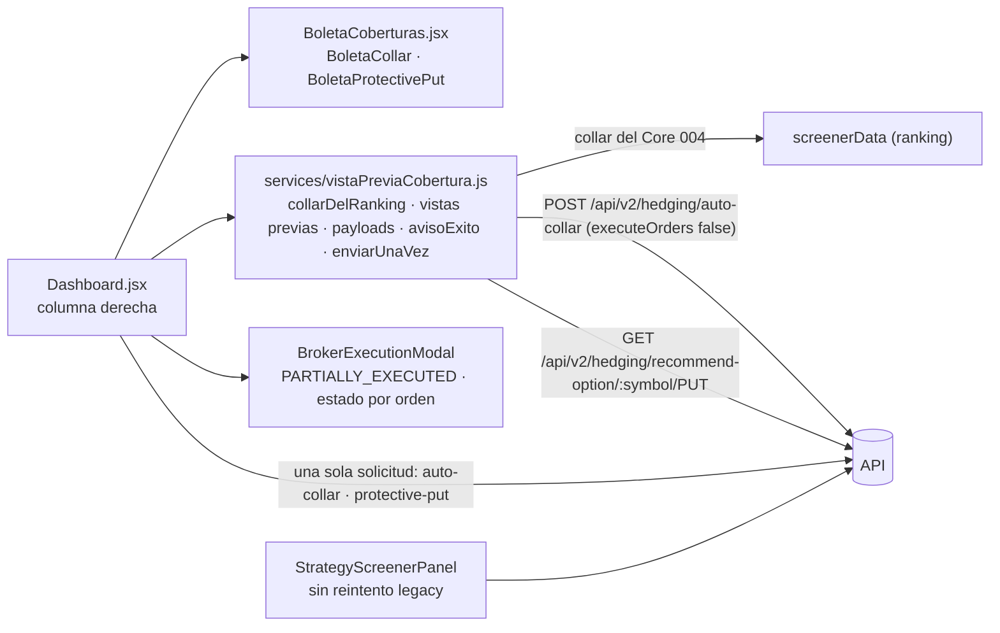

# REPORT-DrFIC — `panel-de-ordenes-con-datos-reales`

## Resumen ejecutivo

La terminal de órdenes de la columna derecha ya no muestra ni envía valores inventados:

- **Sin candidato fabricado**: antes había una prima de $4.50 y probabilidades de 92 % y 78 %. Ahora, fuera del ranking, solo se conocen el símbolo y su precio, si existe.
- **Auto-Collar**: muestra el **collar del Core 004 del ranking**, rotulado «Collar» con su costo neto. Si el activo no lo tiene, muestra la vista previa del backend. Al emitir, envía esos contratos para que se coticen de nuevo.
- **Protective Put**: muestra el **Put recomendado real**, con su ask, instante y fuente, y envía su `contractSymbol` en lugar de una prima.
- **Sin vista previa**: la cobertura se deshabilita y se muestra la causa, sin primas ni probabilidades.
- **Avisos y modal**: el aviso de éxito usa las órdenes y los strikes de la respuesta, no `orders.length || 3` ni los strikes del escáner. Ante un `409`, el modal destaca `PARTIALLY_EXECUTED` y el estado y la cantidad ejecutada de cada orden.
- **Reintentos retirados**:
  - el del screener, que repetía la consulta sin los tickers del usuario;
  - el v2→v1 del Auto-Collar, que podía duplicar órdenes.

  Ante un error de red, el panel indica que el resultado es desconocido y que se revisen las órdenes en el broker.

## Atribución: trabajo de IA y trabajo manual

| Trabajo | Autoría |
|---|---|
| Pruebas, implementación, capturas de la boleta y del modal, y este reporte | Asistido por IA (Claude Code), a solicitud de Eddie Altamirano |
| Revisión del Dashboard completo con sesión real, en escritorio y móvil (tarea 3.1) | **Pendiente (manual)** |
| Revisión humana del código | Pendiente |

## Diagrama C4 (nivel de componentes)

## Lógica integrada

- **Vista previa**:
  - Collar: `collarDelRanking` usa el resultado del Core 004 del ranking; si no existe, `cargarVistaPreviaCollar` pide `executeOrders: false`.
  - Protective Put: `cargarRecomendacionPut`.
  - Los efectos se recargan al cambiar de activo, de pestaña o de broker, y descartan respuestas viejas.
- **Emisión**: `enviarUnaVez` hace una sola solicitud.
  - Ante `401`, pide iniciar sesión y no reenvía.
  - Ante un error de red, informa un resultado desconocido.
  - El Auto-Collar envía `putContractSymbol` y `callContractSymbol`. El Protective Put envía `contractSymbol` y ya no `putPremium` ni `spotPrice`.
- **Modal**:
  - Lee `orders` de la respuesta (también dentro de `data` en el Protective Put).
  - Muestra el estado del broker o «sin estado del broker» en lugar de `submitted`, la cantidad ejecutada, la verificación en el libro, la cancelación y el mensaje de rechazo.
  - Distingue «Prima observada (vista previa)» de la teórica del escáner y retiró los respaldos 200/190/4.5 de la pérdida máxima.
- **Panel de cores**: se retiró el reintento con `limit: 10` sin `extraSymbols`; se muestra el error de la consulta original.
- **Encabezado del gráfico**: el spot muestra «sin cotización» si no existe, y los strikes del escáner se rotulan «(teórico)» solo cuando existen.

## Registro de tareas

Los tiempos son las fechas de modificación reales de los archivos de cada tarea (UTC−07:00).

| Tarea | Archivo | Momento |
|---|---|---|
| 1.1 Pruebas de componente y del servicio (fase roja) | `vistaPreviaCobertura.spec.js`, `BoletaCoberturas.spec.jsx` | 2026-11-20 23:46:29 |
| 2.1 Servicio de vista previa y payloads | `vistaPreviaCobertura.js` | 2026-11-20 23:47:17 |
| 2.3 Reintento del screener retirado | `StrategyScreenerPanel.jsx` | 2026-11-20 23:48:11 |
| 2.2 Modal con `PARTIALLY_EXECUTED` y sin respaldos | `BrokerExecutionModal.jsx` | 2026-11-20 23:48:54 |
| 2.1–2.3 Boleta y conexión en el Dashboard | `Dashboard.jsx`, `BoletaCoberturas.jsx` | 2026-11-20 23:50:30 |

## Verificación

- **Vitest**: 53 de 53, con 10 pruebas nuevas:
  - collar del ranking rotulado «Collar» con su costo neto;
  - vista previa del backend;
  - payloads sin prima ni spot;
  - aviso con los strikes de la respuesta;
  - una sola solicitud ante un error de red;
  - boleta con el Put real;
  - boleta sin datos, deshabilitada y sin `$` ni `%`;
  - modal `409`;
  - error de cores sin reintento.
- **Build**: correcto.
- **`npm test` (backend)**: 133 de 133; sin cambios de backend en este change.
- **Capturas** con los componentes reales en una página auxiliar y datos reales (collar del Core 004 de AAPL del 2026-11-20 y Put recomendado real), en 420 px:
  - boleta con collar;
  - boleta con Put;
  - boleta sin vista previa;
  - modal `409` en escritorio.

  Están en el scratchpad de la sesión (`boleta.png`, `modal-409.png`).

- **Recorrido con sesión real** (2026-11-21): Chrome headless controlado por DevTools, con inicio de sesión desde el formulario contra el backend local y registro de cada llamada a `/api`. Se recorrió Dashboard, detalle de core y Portafolio con MongoDB/Webull, Supabase/IBKR y MongoDB/Alpaca a 1440 px, y con Supabase/Alpaca a 390 px.
  - Todas las llamadas respondieron `200`, con `Authorization`, `x-database-selection` y `x-broker-selection` correctos. Los `ERR_ABORTED` son la cancelación esperada del doble montaje de StrictMode.
  - Una vista previa respondió `503` una vez por una falla momentánea del proveedor de datos, y la repetición respondió `200`.
- **Corregido durante la verificación**:
  - El Dashboard entraba en un ciclo de renders («Maximum update depth exceeded», 55 avisos), que ya existía en `HEAD`. `candidates` era un arreglo nuevo en cada render mientras cargaba el escáner, y el efecto de selección volvía a fijar el activo. Ahora es un arreglo estable y el activo solo cambia si cambian sus datos.
  - Se eliminaron spots inventados: el inicial 227.5, el respaldo `|| 200` y el spot de otro activo al elegir una tenencia.
  - El resumen sumaba contratos de Webull como acciones (SPY «6 acciones» en vez de 600). Ahora usa `equityQty`.
  - La tabla del Portafolio describe el contrato: `Covered Stock (200 acciones) · CALL 740 2026-12-31`, `PUT 215 2026-12-18`.

## Riesgos de integración por etapa

| Etapa | Riesgo | Mitigación |
|---|---|---|
| Backend en Render (`main`) | No tiene la vista previa ni `putContractSymbol` | Desplegar junto con `cadena-de-opciones-real` y `ejecucion-de-coberturas-multipata` |
| Uso | Sin vista previa no se puede emitir una cobertura | Comportamiento buscado; la causa queda visible |
| Horario | Fuera de sesión la vista previa usa cotizaciones de cierre, y Alpaca puede responder `503` al emitir | Se informa el instante y la causa |

## Pendientes, sin marcar como hechos

- Revisión humana; commit y despliegue solo con instrucción explícita (todo en local).
