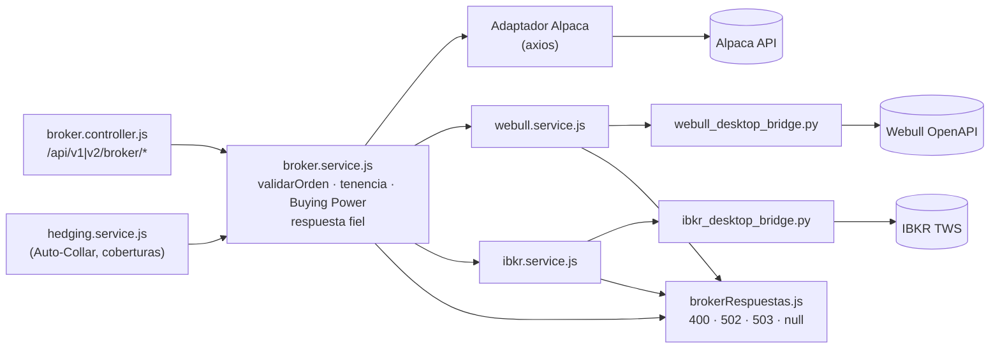

# REPORT-DrFIC — `ordenes-y-lecturas-fieles-al-broker`

## Resumen ejecutivo

Las órdenes directas, las cancelaciones y las lecturas de cuenta, posiciones, órdenes y cotizaciones de Webull, Alpaca e IBKR ahora reflejan solo lo que reporta el broker:

- **Órdenes incompletas**: se rechazan con `400` antes de contactar al broker, sin precios, strikes, vencimientos ni tipos por defecto. Las órdenes `market` se envían sin precio límite.
- **Buying Power**: se valida también en compras `market`, con el `ask` observado.
- **Tenencia**: la validación de ventas cuenta solo acciones, no contratos de opciones.
- **Respuestas de emisión**: `201` solo con el identificador del broker. Estado y cantidad ejecutada son los del broker o `null`.
- **Cancelaciones**: son exitosas solo si el broker las confirma.
- **Lecturas**: los campos no reportados quedan en `null`, con `502`/`503` en lugar de listas vacías o saldos de 1,000,000.

Con la cuenta paper real, la validación de tenencia de AAPL en Webull ahora cuenta **100 acciones** (un `COVERED_STOCK`). Antes contaba **7**: sumaba 5 contratos Put y un Put suelto como si fueran acciones.

## Atribución: trabajo de IA y trabajo manual

| Trabajo | Autoría |
|---|---|
| Muestra de posiciones, pruebas, implementación, contrato, verificación de lectura y este reporte | Asistido por IA (Claude Code), a solicitud de Eddie Altamirano |
| Verificación manual emitiendo y cancelando órdenes en la cuenta paper | **Pendiente (manual)**: la IA no envió órdenes reales |
| Revisión humana del código | Pendiente |

## Diagrama C4 (nivel de componentes)

## Lógica integrada

- **Un solo punto de validación** (`validarOrden` en `createBrokerOrder`), antes de las salvaguardas y de elegir el broker. Aplica igual a las órdenes del Auto-Collar (`hedging.service.js`), cuyas cargas ya eran completas.
  - Exige `instrumentType`, `side`, `type`, `qty` entera positiva y `limitPrice` en `limit`.
  - En opciones exige contrato completo: `optionType`, `strikePrice` y `expirationDate`, o un `contractSymbol` OCC coherente con ellos.
  - `COVERED_STOCK` exige `stockPrice`.
- **Buying Power**:
  - Costo = cantidad × precio límite, o el `ask` observado en `market`; × 100 en opciones.
  - Una compra de opción a mercado responde `503`, porque no hay cotización observada del contrato.
  - Si no se puede leer la cuenta o la cotización, `503`.
- **Tenencia**: suma `equityQty` de las posiciones del símbolo; si un broker no la informa, `502`.
  - Webull agrupa por estrategia. Según la muestra real del 2026-11-20, el tipo real está en cada pata, y en `COVERED_STOCK` las acciones son `quantity × option_contract_deliverable`.
  - IBKR usa `secType`.
  - Alpaca usa `asset_class`.
- **Códigos**: `brokerRespuestas.js` traduce las respuestas:

  | Situación | Código |
  |---|---|
  | El broker rechaza (4xx) | `400`, con su mensaje literal |
  | Respuesta ilegible o sin identificador | `502` |
  | El broker no responde | `503` |

- **Puente de Webull**:
  - El identificador de cuenta ya no tiene valor por defecto.
  - Cuenta, órdenes y cotización ya no usan valores supuestos.
  - Los argumentos son obligatorios y `MARKET` va sin `limit_price`.
  - `COVERED_STOCK` ya no usa la cotización de respaldo de 220.
  - La cancelación es exitosa solo con `200`; si fallan las dos rutas, se informan ambas causas.
  - Se retiró `--preview`, que no se usaba.
- **Puente de IBKR** (lecturas):
  - La cotización ya no inventa `bid`/`ask` (±0.05), nombre de empresa ni `peRatio: 28.5`.
  - La cancelación ya no informa «Orden simulada … cancelada» como éxito cuando TWS no responde.
- **Cliente**: la verificación previa de venta en `Dashboard.jsx` usa `equityQty`. Es un ajuste mínimo, alineado con la misma regla del backend.

## Registro de tareas

Los tiempos son las fechas de modificación reales de los archivos de cada tarea (UTC−07:00).

| Tarea | Archivo | Momento |
|---|---|---|
| 1.1 Muestra real de posiciones de Webull (solo lectura, anonimizada) | `docs/evidencias-pruebas-api/webull-posiciones-muestra-2026-11-20.json` | 2026-11-20 20:14:45 |
| 1.2 Pruebas `node:test` (fase roja: 11 fallidas) | `test/broker.ordenes.test.js`, `test/portafolio.test.js` | 2026-11-20 20:14:36 |
| 2.1–2.4 Validación, salvaguardas, respuestas y lecturas | `brokerRespuestas.js`, `broker.service.js` | 2026-11-20 20:16:53 |
| 2.3–2.4 Webull e IBKR | `webull.service.js`, `ibkr.service.js` | 2026-11-20 20:17:53 |
| 2.4 Puente de IBKR (cotización y cancelación) | `scripts/ibkr_desktop_bridge.py` | 2026-11-20 20:18:09 |
| 1.3 Pruebas `unittest` del puente (fase roja: 7 fallidas) | `test/webull_ordenes_puente_test.py` | 2026-11-20 20:18:40 |
| 2.5 Puente de Webull | `scripts/webull_desktop_bridge.py` | 2026-11-20 20:19:22 |
| 2.2 Verificación previa de venta en el cliente | `client/src/components/Dashboard.jsx` | 2026-11-20 20:19:35 |
| 3.1 OpenAPI y Postman | `spec/openspec.yaml` y colecciones | 2026-11-20 20:20:28 |
| 3.2 Pruebas de calidad de API | `docs/evidencias-pruebas-api/resultados.json` | 2026-11-20 20:20:52 |

## Verificación

- **`npm test`**: 110 de 110. Incluye 9 pruebas nuevas:
  - parámetros obligatorios;
  - `market` sin precio y Buying Power con el `ask`;
  - cuenta ilegible;
  - tenencia solo de acciones;
  - `201`/`400`/`502`/`503` en Webull y Alpaca;
  - cancelación confirmada;
  - lecturas sin valores supuestos;
  - posiciones de IBKR.

  Las aserciones anteriores que esperaban `[]` al fallar una lectura ahora esperan `503`.
- **`.venv/bin/python3 -m unittest test/webull_ordenes_puente_test.py test/portafolio_puentes_test.py`**: 9 de 9.
- **`npm run test:api-quality`**: `RESULTADO PASS: 108 pruebas aprobadas, 0 fallidas`. Los 5 hallazgos de seguridad y monitoreo que registra ya existían.
- **Cliente**: Vitest 39 de 39 y build correcto.
- **Cuentas paper reales** (solo lectura, 2026-11-20 20:21 −07:00):

  | Broker | Lectura | Resultado |
  |---|---|---|
  | Webull | Cuenta | Efectivo, valor y Buying Power reportados |
  | Webull | Cotización AAPL | 342.56, con bid 339.94 y ask 345 |
  | Webull | Posiciones AAPL | `SINGLE` de 5 contratos → 0 acciones; `COVERED_STOCK` → 100 acciones |
  | Webull | Órdenes | 10 |
  | Alpaca | Cuenta | Leída |
  | Alpaca | Cotización AAPL | 343.40 con `ask: null` después del cierre (antes se inventaba último + 0.05) |
  | Alpaca | Órdenes | 20 |

  Rechazos sin contactar al broker:
  - `limit` sin precio: `400`;
  - opción sin vencimiento: `400`;
  - venta de 100,000 AAPL: `400` («WEBULL reporta 100 acciones»).
- **Órdenes reales en paper con curl** (2026-11-21, sábado, mercado cerrado; autorizado por el usuario, sin dobles de prueba):

  | Broker | Caso | Resultado |
  |---|---|---|
  | Alpaca | Compra `limit` de 1 AAPL a 206 y Put `AAPL261231P00330000` a 0.05 | `201` ambas; listadas en abiertas; cancelación `200` de las dos |
  | IBKR | Compra `limit` de 1 AAPL a 205 y el mismo Put a 0.05 | `201` ambas (ids 452 y 456); cancelación `200` con estado `Cancelled` |
  | IBKR | Cancelar otra vez la orden 452 | `400` («TWS no tiene una orden 452») |
  | IBKR | Compra `market` de 1 AAPL | TWS la recibe y la cancela con la sesión cerrada: `400` con el código 10349 |
  | Alpaca | Compra `market` de 1 AAPL | `503` («no informó el ask»), sin enviar la orden |
  | Webull | Compra `limit` y Put | `400`: Webull rechaza órdenes fuera de horario (`OPENAPI_CAN_NOT_TRADING_FOR_NON_TRADING_HOURS`) |

  Al terminar, las tres cuentas quedaron con 0 órdenes abiertas.
- **Corregido durante la verificación**:
  - Un rechazo de negocio de Webull (HTTP 417 del SDK) se informaba como `503` «no respondió»; ahora es `400` con el motivo del broker.
  - Una orden que TWS cancela al recibirla se informaba como `503`; ahora es `400`.
  - La cancelación en IBKR esperaba 1 segundo y respondía `502` si TWS seguía en `PendingCancel`. Ahora espera hasta 6 segundos y, si sigue pendiente, responde `202` con el estado que informa TWS.
- **Pendiente con mercado abierto**: una orden `market` aceptada (IBKR cancela las de fin de semana y Alpaca no informa `ask`) y las órdenes de Webull. Por eso la tarea 3.2 no se marca como terminada.

## Riesgos de integración por etapa

| Etapa | Riesgo | Mitigación |
|---|---|---|
| Panel | Aparecen `400`/`502`/`503` donde antes había valores, listas vacías o éxitos | Son errores reales; el panel ya los muestra en el modal y en la tarjeta de portafolio |
| Clientes externos | Las órdenes sin `instrumentType` ahora responden `400` | Se actualizaron los 7 ejemplos de cada colección Postman y el contrato |
| Compras a mercado | Fuera de horario, Alpaca/IEX no informa `ask`: `503` | Usar órdenes `limit`; es el comportamiento correcto sin cotización |
| Webull | Las acciones de un `COVERED_STOCK` cuentan como tenencia, y venderlas dejaría la Call descubierta | El broker decide; queda para `ejecucion-de-coberturas-multipata` |
| `spawnSync` | Más llamadas al puente (cotización para el Buying Power) | Fuera de alcance; documentado |
| Fuera de alcance | La cadena de opciones de Alpaca y Webull sigue siendo sintética (`Math.random`) | `cadena-de-opciones-real` |

## Hallazgos fuera de alcance (para decisión del equipo)

1. **El puente de IBKR emite órdenes ocultas**: al vender una Call (`place_order` con `--instrument_type OPTION --action SELL --option_type CALL`), compra a mercado las acciones que falten para cubrirla, sin que el usuario lo pida.
2. **El puente de IBKR convierte un `LIMIT` sin precio en `MarketOrder`**. Ahora no ocurre, porque el servicio exige `limitPrice`, pero el puente sigue permitiéndolo.
3. **Credenciales en el código**: `scripts/webull_desktop_bridge.py` tiene como valores por defecto la `APP_KEY`/`APP_SECRET` de Webull (y `src/config/config.js` las de Alpaca). Conviene rotarlas y quitar los valores por defecto.

## Pendientes, sin marcar como hechos

- Con mercado abierto (desde el lunes 2026-11-23, 9:30 ET): una orden `market` y las órdenes de Webull en paper (tarea 3.2).
- Revisión humana del código y de este reporte.
- Commit y despliegue, que solo se hacen con instrucción explícita. El usuario pidió mantener todo en local por ahora.
