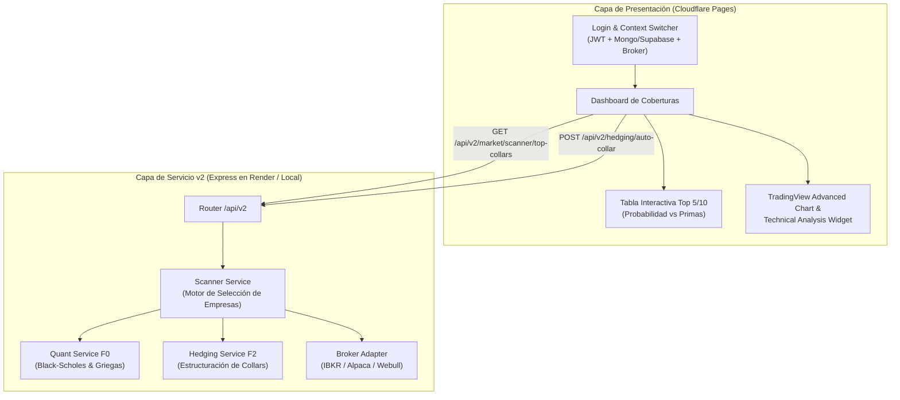

# Design: Arquitectura del Screener Cuantitativo v2, TradingView y Cliente React

## 1. Visión General de la Arquitectura v2

La arquitectura evoluciona de un modelo centrado en peticiones punto a punto (`/api/v1`) a una plataforma de inteligencia financiera distribuida (`/api/v2`).



---

## 2. Modelo Matemático y Algorítmico del Screener

El servicio [`scanner.service.js`] implementa un proceso cuantitativo en 5 etapas:

### Etapa A: Selección de la Canasta de Mercado
Se define una canasta de activos subyacentes con volumen diario superior a 10 millones de acciones y un mercado de opciones ultra-líquido (*Penny Pilot Program*):
* `AAPL` (Apple Inc.)
* `MSFT` (Microsoft Corp.)
* `NVDA` (NVIDIA Corp.)
* `GOOGL` (Alphabet Inc.)
* `AMZN` (Amazon.com Inc.)
* `META` (Meta Platforms Inc.)
* `TSLA` (Tesla Inc.)
* `AMD` (Advanced Micro Devices)
* `SPY` (SPDR S&P 500 ETF Trust)
* `QQQ` (Invesco QQQ Nasdaq-100 Trust)

### Etapa B: Horizontes Temporales (DTE - Days To Expiration)
El screener evalúa vencimientos estándar:
1. **Corto Plazo (30 días)**: Máxima velocidad de decaimiento temporal ($\Theta$), ideal para capturar primas rápidamente.
2. **Medio Plazo (45 días)**: *Sweet spot* institucional según la literatura cuantitativa (CBOE), donde el balance entre prima cobrada y margen de maniobra es óptimo.
3. **Largo Plazo (60 días)**: Para posturas defensivas ante incertidumbre macroeconómica.

### Etapa C: Calibración de Collar a Costo Cero
Para cada símbolo en la canasta:
1. Obtener precio spot en vivo ($S$) y cadena de opciones del broker.
2. Filtrar Puts OTM ($K_{put} \approx S \times 0.95$) y Calls OTM ($K_{call} \approx S \times 1.05$).
3. Seleccionar la combinación que minimice el flujo neto:
   $$\text{NetPremium} = \text{Premium}_{Call} - \text{Premium}_{Put}$$
   * Si $\text{NetPremium} \ge 0$, la estrategia genera un **Crédito Neto** (te pagan por proteger tu cartera).
   * Si $\text{NetPremium} < 0$, genera un **Débito Menor**.

### Etapa D: Evaluación de Probabilidades Estocásticas con Black-Scholes
Utilizando la variable estandarizada $d_2$ del modelo de Black-Scholes:
$$d_2 = \frac{\ln(S / K) + \left(r - \frac{\sigma^2}{2}\right) T}{\sigma \sqrt{T}}$$

1. **Probabilidad de Piso Seguro (*Floor Protection Probability*)**:
   $$P_{\text{Piso}} = N(d_2(K_{put}))$$
   Mide la probabilidad neutral al riesgo de que la acción termine en o por encima del strike de protección $K_{put}$, es decir, que la posición no sufra caídas mayores al deducible pactado.
2. **Probabilidad de Rango Óptimo (*Sweet Spot Probability*)**:
   $$P_{\text{Rango}} = N(d_2(K_{call})) - N(d_2(K_{put}))$$
   Mide la probabilidad de que el precio termine entre el piso y el techo, permitiendo conservar las 100 acciones y embolsarse las primas sin ser ejercido.
3. **Puntuación Compuesta (*Composite Score*)**:
   $$\text{Score} = (P_{\text{Piso}} \times 0.5) + (\text{Rendimiento Máximo \%} \times 0.3) + (\text{Crédito Neto} \times 0.2)$$

### Etapa E: Doble Criterio de Ordenamiento
El usuario puede solicitar el ranking ordenado por:
* `sortBy = "probability"` (por defecto): Prioriza las empresas más seguras y resilientes.
* `sortBy = "netCredit"`: Prioriza las empresas que generan **mayor prima neta** de entrada, permitiendo verificar de inmediato si, por ejemplo, `NVDA` (puesto #3 en seguridad) ofrece \$2.50 USD de prima mientras `AAPL` (puesto #1) ofrece \$0.30 USD.

---

## 3. Integración Oficial con TradingView

La aplicación integra la librería embebible de TradingView en dos componentes reactivos:
1. **Widget de Gráfico Avanzado en Tiempo Real (`TradingView.widget`)**:
   Renderiza velas japonesas interactivas con volumen, soportes, resistencias y medias móviles simples (SMA 50 y SMA 200).
2. **Widget de Análisis Técnico (`Technical Analysis Widget`)**:
   Muestra un velocímetro dinámico de síntesis técnica basado en osciladores (RSI, Estocástico) y medias móviles, calificando la acción en:
   * **COMPRA FUERTE (*Strong Buy*)**
   * **COMPRA (*Buy*)**
   * **NEUTRAL**
   * **VENTA (*Sell*)**

Esto permite validar en un solo vistazo si la empresa elegida por el screener cuenta con confirmación técnica alcista.

---

## 4. Despliegue en Cloudflare Pages

El frontend se estructura como una SPA moderna utilizando **Vite + React + Tailwind CSS**:
* Directorio: `client/`
* `dist/`: Carpeta de artefactos estáticos generada mediante `npm run build`.
* Archivo de redirecciones `client/public/_redirects`:
  ```text
  /*    /index.html   200
  ```
  Garantiza que el enrutamiento interno de React funcione a la perfección en la infraestructura Edge de Cloudflare sin errores 404.
* Variables de entorno: `VITE_API_URL` apuntando a la URL del backend (`localhost:3000`, túnel de Cloudflare o Render).
